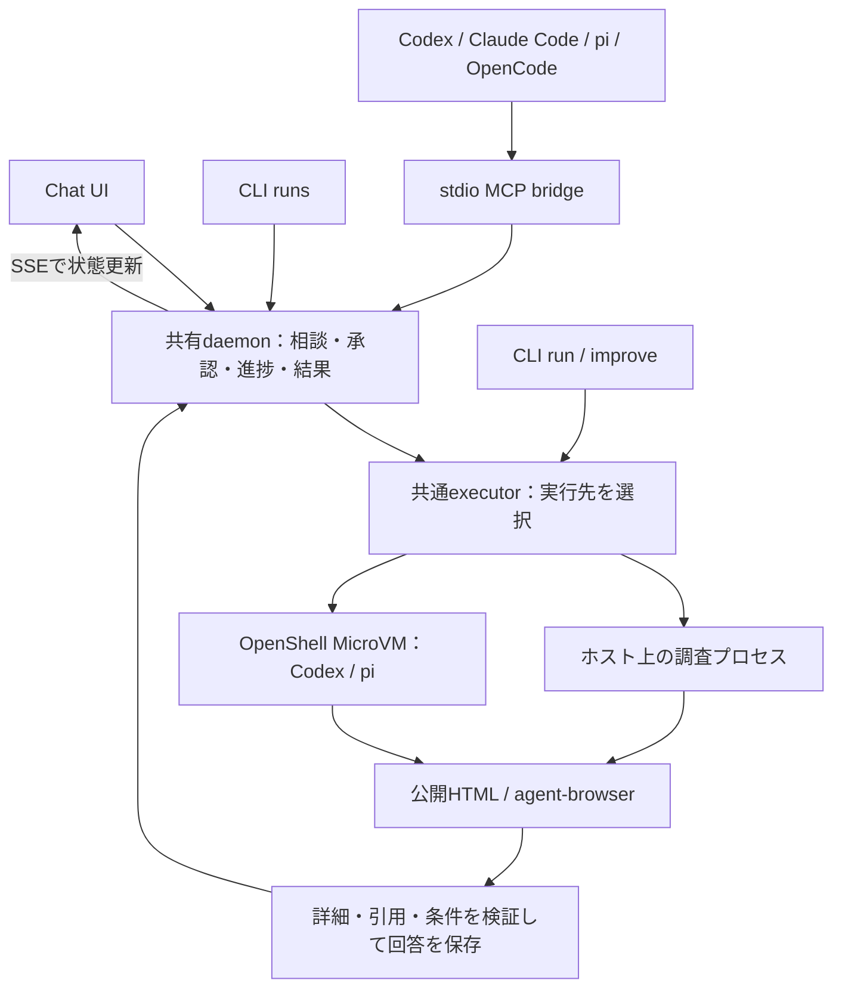

# web-harness-runtime

自然言語の相談と複数の公開URLを受け取り、ページの詳細取得・引用・条件の照合を行う自律調査runtimeです。同じ調査を **Chat UI・CLI・MCP** から利用できます。Recruit／楽天の美容、宿泊、飲食、住居、車、求人などを対象にしています。予約・購入・応募は行いません。

Chatは白黒を基調に青・シアンを合わせたローカルUIです。調査の進捗を順次表示し、回答を行程フロー・写真付き候補カードで見渡せます。カードを押すとMarkdownの詳細、取得リンクを押すと「ページ画像／Web画面／本文・引用」を開けます。

## 実際の画面とアウトプット

次は、上野の一日遊びについて**保存済みの実調査結果を表示した実画面**です。行程を図解で見渡し、候補・予算・雨天代替を押して詳しく読めます。表示変換で新しい推薦を生成せず、元の回答にある未確認事項も残します。


| クリックして読むMarkdown詳細 | 元のWeb画面を確認するプレビュー |
| --- | --- |
|  |  |
| 行程、条件の照合、予算、引用、未確認事項を読みやすく整形 | 「ページ画像／Web画面／本文・引用」を切替。元ページへのリンクも表示 |

- **入力例**：大人2人と5歳児で上野を一日楽しみたい。家族16,000円以内、休憩2回、雨天の案もほしい。
- **回答例**：動物園と昼食を中心に、疲れたら早めに帰り、元気なら科博を追加する行程。掲載料金と未確認の予算枠を分け、対象日の営業・空席は未確認として返却。
- **受け取れるもの**：図解、候補カード、Markdownの詳細、取得URLと引用、機械可読JSON、取得できた時間・トークン・費用の記録。

**[画面・出力・構成ガイド](docs/product-guide.md)**に、初期画面、承認、候補、写真、Web画面、スマートフォンの計8枚と、具体的な操作・出力・保存データの読み方を載せています。掲載画像は個人の履歴・認証を使わない一時環境で撮影し、写真・Web画面だけを表示用に別途取得しました。撮影情報は[manifest](docs/screenshots/chat-manifest.json)に記録しています。

## 全体の構成



Chat・CLIの`runs`・MCPは同じ相談を操作し、単発の`run`はexecutorを直接使います。Chat/APIの制御と表示用プレビューはホスト、調査プロセスは選んだlocalまたはMicroVMで動きます。localへ暗黙にfallbackしません。図解とMarkdownは保存された回答を整形した表示です。

詳細な境界、Auto/Approvalの状態遷移、1回の調査の流れ、コード配置は[構成ガイド](docs/product-guide.md#architecture)を参照してください。

## 1. キーなしでChatを体験する

必要なものはNode.js 22以降とnpmです。リポジトリのディレクトリで実行します。

```sh
npm ci
npm run build
npm run chat -- --port 4311
# ブラウザで http://127.0.0.1:4311/chat を開く
```

左側で「一日のお出かけ」「これからの暮らし」「根拠から選ぶ」を選び、「保存済み実測で体験」のまま相談を始めます。保存済みの公開サイト調査を再生するため、APIキー・モデルへのログイン・OpenShellは不要です。新しい質問に対する推論ではありません。条件を変えるときは「実調査」を選びます。

| 進め方 | 動作 |
| --- | --- |
| Approval | 調査前に推奨案と選択肢を表示。「この選択で進む」を押すまで実調査を始めません。調査後に未確認が残ると、受領・追加調査・同一候補のURL追加を選べます |
| Auto | 推奨方針をruntimeが選び、承認待ちを作りません。未確認は未確認と明記して部分回答を返します |

回答後は入力欄を折り畳みます。「条件を変えて、もう一度相談する」から再度開けます。上部の「取得リンク」から出典一覧へ移動できます。本文は保存済みの取得記録です。写真は掲載元の公開画像、Web画面はagent-browserによる実際のキャプチャで、調査本文とは別の取得日時を表示します。表示用の取得はローカルChat側で行い、調査の判断や引用を更新しません。取得できない画像・画面は代替の写真で埋めません。

従来のチーム会話型Workbenchは `http://127.0.0.1:4311/`。単独で試す場合は `npm run web`（既定ポート4310）です。Workbenchの体験モードは旅行・暮らしの架空テンプレートで、Chatの保存済み実測とは異なります。

終了は起動したターミナルでCtrl+C。同じ保存先を使うdaemonは1つにし、ブラウザ・CLI・MCPで共有してください。Chat/APIはloopback専用です。

## 2. 環境変数を設定する

保存済み実測の再生には `.env` は不要です。実調査で追加設定が必要なら、既存ファイルを上書きせず作成します。

```sh
test -e .env || cp .env.example .env
# .envをローカルのエディタで編集する
```

CLIは作業ディレクトリの `.env` を読みます。既にプロセスへ設定された環境変数を優先します。値を変更したらdaemonを再起動してください。`.env`、認証ファイル、キーの内容をチャット・Git・コマンド引数へ貼り付けないでください。[.env.example](.env.example)には空値と設定例だけを置いています。

### 共通設定

| 変数 | 既定値 | 用途 |
| --- | --- | --- |
| `RUNTIME_AGENT` | `codex` | `codex` / `claude-code` / `pi-openrouter` / `opencode` |
| `RUNTIME_EXECUTOR` | `local` | `local`はホストプロセス、`openshell`は設定済みsandbox。未接続時にlocalへ自動切替しません |
| `RUNTIME_DIR` | `.runtime` | タスク・相談・承認・ページ本文・画像・ログ等の保存先 |
| `HARNESS_URL` | `http://127.0.0.1:4310` | `runs` CLI / MCP bridgeの接続先daemon。このREADMEのChat例は4311なので、接続先を4311へ設定するか`--endpoint` / `--url`を明示 |
| `TRUSTED_URLS_FILE` | `RUNTIME_DIR/trusted-urls.json` | 実行時のtrusted URL台帳。未作成なら同梱台帳を期限確認して利用 |
| `AGENT_BROWSER_EXECUTABLE_PATH` | agent-browserのブラウザ | 既存Chrome/Chromiumを使う場合の実行ファイルの絶対パス |

### エンジン別設定

| 変数 | 必要な場合・意味 |
| --- | --- |
| `CODEX_BIN` | Codex CLIのパス。未指定はPATH上の`codex` |
| `CODEX_MODEL` | `codex-doctor`で利用可能なモデルを指定。未指定はアカウントの既定モデル |
| `CLAUDE_BIN` | Claude Code CLIのパス。未指定はPATH上の`claude` |
| `CLAUDE_MODEL` | 実装が対応する`claude-sonnet-5-5`（既定）または`claude-haiku-5-5`。利用できる契約・CLIが必要 |
| `OPENROUTER_API_KEY` | pi/OpenRouterでのみ必要な秘密値。Codex・Claudeのサブスク認証とは別 |
| `OPENROUTER_MODEL` | 現在のカタログに存在する無料・全料金ゼロ・ツール対応モデル。未指定は条件を満たすモデルを選択 |
| `OPENCODE_BIN` | 既存OpenCodeの実行パス。検証構成の既定値は`/private/tmp/strata-opencode/node_modules/.bin/opencode`。別環境では明示設定 |
| `OPENCODE_MODEL` | 既定は`strata-colab/qwen3.8-flash-next-iq2_xs`。既存Strataのモデル一覧に一致する必要あり |
| `STRATA_BASE_URL` | StrataのOpenAI互換endpoint。未指定は管理接続、なければ`http://127.0.0.1:18081/v1` |
| `STRATA_KEY_FILE` | Strataキーの絶対パス。未指定は管理接続、なければ`/private/tmp/strata-colab-api-key`。Git管理外に置く |
| `STRATA_API_KEY` | キーファイルの代わりに環境から渡す秘密値。指定時は`STRATA_KEY_FILE`より優先 |

CodexはChatGPTログイン、Claude Codeは自身のサブスクログインを使います。この接続でOpenAI / Anthropic APIキーを代用しません。モデル名は実装・実測時点の対応名で、契約や提供状況により使用できない場合は停止します。pi/OpenRouterは無料枠切れでも有料モデルへfallbackしません。

## 3. ローカルで実調査する

利用する公式エージェントCLIを別途導入・ログインしてください。Codexの場合：

```sh
codex login
npm run browser:install
npm start -- codex-doctor
RUNTIME_EXECUTOR=local RUNTIME_AGENT=codex npm run chat -- --port 4311
```

Chatで「実調査」を選び、質問と公開URLを入力します。`AGENT_BROWSER_EXECUTABLE_PATH`で既存Chromeを指定するならブラウザのダウンロードを省略できます。実調査はモデルの利用枠と外部サイト通信を使い、数分かかる場合があります。localはMicroVM隔離ではありません。

CLIから直接調べる例：

```sh
npm start -- run 'この本の書名・税込価格・ISBNを引用つきで教えて' \
  --agent codex --url https://books.rakuten.co.jp/rb/18577690/ \
  --mode auto --json

npm start -- run-file examples/recruit-day-out.json --mode approval --json
npm start -- run-file examples/recruit-life-plan.json --mode auto --json

# 既存の未達を診断・追加調査。条件を満たせなければ部分回答を保持
npm start -- improve TASK_ID --mode auto --iterations 1 --timeout 180 --json
npm start -- show TASK_ID --json
```

別のエンジンを使う場合：

```sh
npm start -- claude-doctor
npm start -- run-file examples/recruit-day-out.json \
  --agent claude-code --model claude-sonnet-5-5 --mode auto --json
npm start -- models --agent pi-openrouter
npm start -- quota
npm start -- run-file examples/recruit-day-out.json --agent pi-openrouter --mode auto --json
npm start -- doctor --agent opencode
npm start -- run-file examples/recruit-day-out.json --agent opencode --mode auto --json
```

通常のOpenCode調査は接続済みStrataを使います。元の会話へattachせず独立したセッションを作り、調査の開始や接続失敗だけでGPUの新規割当・再起動はしません。明示的な起動管理は次の`strata`コマンドを使います。詳しくは[エンジンと追加調査](docs/engines-and-depth.md)、[Codex / Strata](docs/codex-strata.md)。

### Strata × Qwen3.8をColabで起動・接続する

参照セッションのL4・IQ2_XS・64K・SSH転送・無操作停止をCLIに組み込みました。Colabの本人認証は別途必要です。`up`は計算ユニットとモデル取得の通信を使います。

```sh
npm run build
npm start -- strata install  # Python 3.12以降。既存CLIはCOLAB_BINで指定可能
npm start -- strata login    # 本人がGoogleへログイン
npm start -- strata plan     # 割当なしで設定確認
npm start -- strata up       # 専用L4を起動・接続。既定30分の無操作停止監視
npm start -- strata probe    # 認証 / SSE / tool call→resultを検証
npm start -- strata chat --port 4311
# 使い終わったらGPU全体の解放を確認
npm start -- strata stop
npm start -- strata status
```

管理接続はGit管理外の`connection.json`からOpenCode adapterへ自動的に渡します。通常の`run --agent opencode`や対話型`strata client pi` / `strata client opencode`は新規GPUを割り当てません。既存endpointだけ使う場合は`strata connect --url ... --key-file ...`を使い、他ツールが所有するColabは停止しません。

**[起動・接続・停止・環境変数の詳細](docs/strata-colab.md)**。OpenCodeの調査はホスト、推論はColabであり、OpenShell隔離とは別です。通信断やホストのスリープ中は停止監視を継続できないため、利用終了時は`stop`と`status`で確認します。

## 4. OpenShell / MicroVMでCodexを実行する

| 調査エンジン | local | OpenShell |
| --- | --- | --- |
| Codex | 対応 | VM内でログインした専用workerを直列で再利用し、実行後stop |
| pi / OpenRouter | 対応 | gateway providerを使い、調査ごとにsandboxを作成 |
| Claude Code / OpenCode | 対応 | 調査プロセスのVM内認証は未対応。MCPクライアントとしての利用は可能 |

Apple Silicon MacのローカルMicroVM手順です。Docker、`e2fsprogs`、OpenShell gateway用とChat用の別ターミナルが必要です。Linux / remote self-host環境は[OpenShell手順](docs/openshell.md)を参照してください。

```sh
# 初回：依存とイメージを準備
brew install e2fsprogs
npm run build
docker build -f infra/openshell/Dockerfile -t web-harness-runtime:local .
docker build -f infra/openshell/Dockerfile.codex -t web-harness-codex:local .
npm run sandbox:local -- setup
npm run sandbox:local -- start
# gatewayはこのターミナルで維持する
```

別ターミナルで初回登録・本人ログインを行います。ホストの認証ファイルをコピーしません。

```sh
npm run sandbox:local -- register
npm run sandbox:local -- codex-setup
npm run sandbox:local -- codex-login
# 公式のdevice-code画面で本人がログイン。コードや認証ファイルを共有しない
npm run sandbox:local -- run-codex chat --port 4311
```

導入済みならgatewayを起動し、最後の`run-codex chat`だけで再利用します。認証済みworkerを再作成しないでください。結果は回収後にVMをstopしますが、認証ディスクは保持します。piを使う場合は `.env` のOpenRouterキーを設定したうえで `npm run sandbox:local -- init-provider` を実行し、`npm run sandbox:local -- run chat --port 4311` を使います。

通常CLIから設定する場合の環境変数：

| 変数 | 用途 |
| --- | --- |
| `OPENSHELL_GATEWAY` | 登録済みgateway名。通常のopenshell executorでは必須 |
| `OPENSHELL_BIN` | OpenShell CLIの絶対パス。未指定はPATH上の`openshell` |
| `OPENSHELL_IMAGE` | pi用イメージ。既定は`web-harness-runtime:local` |
| `OPENSHELL_PROVIDER` | OpenRouter用gateway provider名。既定は`wh-pi-router`。登録済みprovider名と一致させる |
| `OPENSHELL_CODEX_SANDBOX` | Codex専用worker名。既定は`wh-codex` |
| `OPENSHELL_CODEX_IMAGE` | Codex用イメージ。既定は`web-harness-codex:local` |

Chat/APIと承認処理はホスト、調査プロセスはMicroVMです。表示用の画像・Web画面はローカルChat側で取得します。MicroVM内で成功した調査の取得経路は公開HTMLで、ChromiumのDOM取得には未解決の制約があります。直近の再実行ではポリシー適用待ちによる失敗もあり、接続障害を取得成功とは扱いません。[構成・実測・制約](docs/codex-strata.md)、[2モードとVM運用](docs/runtime-modes.md)。

## 5. daemonをCLI / MCPから操作する

Chatを先に起動しておきます。`runs`は相談IDを返し、同じ相談がChatの履歴にも出ます。

```sh
npm start -- runs start 'この本の税込価格と直筆サイン付きを確認して' \
  --url https://books.rakuten.co.jp/rb/18577690/ \
  --agent codex --mode approval --confirm-live --endpoint http://127.0.0.1:4311
npm start -- runs list --endpoint http://127.0.0.1:4311
npm start -- runs get RUN_ID --endpoint http://127.0.0.1:4311
# getのgate.id / revision / choices[].idを指定
npm start -- runs decide RUN_ID --gate GATE_ID --revision 1 --choice balance \
  --endpoint http://127.0.0.1:4311
npm start -- runs cancel RUN_ID --endpoint http://127.0.0.1:4311

# エージェント用設定を生成する。既存のユーザー設定は変更しない
npm start -- clients --url http://127.0.0.1:4311
```

`.runtime/clients/`にCodex / Claude Code / pi / OpenCode用設定ができます。生成された絶対パスを各クライアント設定へ組み込みます。MCPサーバーは `node /absolute/path/to/repository/dist/cli.js mcp --url http://127.0.0.1:4311` のstdio bridgeです。MCPのstdoutを壊さないよう、クライアントからは`npm start`ではなくNodeを直接起動します。

主なツールは `harness_start` / `harness_get` / `harness_decide` / `harness_cancel`。Approvalの選択は返されたgateとrevisionを使います。MCPクライアントを閉じてもdaemon側の調査は続きます。Chat / CLI / MCPの設定例、HTTP進捗配信、Docker・SSH tunnelでの利用は[詳細usage](docs/usage.md)を参照してください。

配布CLIの作成は `npm run package:cli`。`.runtime/releases/`へtarballを生成し、必要ファイルと秘密ファイルの非混入を検査します。別環境では依存・各エージェントのログイン・daemonの起動が別途必要です。

## 6. trusted URL・自己改善・評価

トップや一覧が開くだけでは取得成功にしません。個別対象の本文、文字品質、領域別の必須項目を確認してtrustedへ登録します。台帳はL0〜L4の情報量分類と有効期限を持ちます。詳細を取得できたことと、希望条件を満たすことは別です。

```sh
npm start -- trusted list --all
npm start -- trusted verify --family rakuten --parallel 2 --timeout 75
npm start -- trusted run '温泉とアクセスを重視して比較して' --source rakuten-travel
npm start -- run-file examples/recruit-day-out.json --self-improve --mode auto --json
npm start -- benchmark check
npm start -- feedback add TASK_ID --rating 4 --helpful yes
```

未達が残れば、同じ対象の子ページ・描画・引用を追加確認します。条件を勝手に変更せず、予算・回数の上限で止めます。未達ゼロを保証する機能ではありません。外部A2A標準の互換実装ではなく、内部メッセージによる割当・レビューです。口コミは店舗等への評判、feedbackは回答への評価として分けます。凍結ベンチマークは暫定ラベルであり、自由文全体の意味的正しさを保証しません。

- [trusted URLの仕様](docs/trusted-urls.md)
- [自己改善ループ](docs/self-improvement.md)
- [正解ラベル・口コミ・回答評価](docs/semantic-quality.md)
- [実回答・時間・費用・現在の制約](docs/delivery-results.md)
- [Recruit / 楽天の実測](docs/codex-family-results.md)
- [3ペルソナの一日遊び結果](docs/day-out-results.md)

## 7. 保存先と安全な共有

`.runtime/`にはページ本文、会話、承認、画像、ログ、VM設定や認証関連の状態が入ります。実際の利用では相談内容に個人情報が含まれ得るため、ディレクトリ全体を共有しないでください。`.env`、各エージェントの認証、鍵・証明書、DB、VMディスク、生成パッケージ・大きな成果物もGitへ入れません。`.gitignore`とDocker contextのallowlistで除外しています。

`docs/evidence/`は公開URLを調べた検証例です。ローカルユーザー名を含むパスは匿名化しています。時間・トークン・費用はその当時の実測で、再生時の費用ではありません。サブスクの追加API課金0を、VM/GPUや契約料金も含む総実費0とは扱いません。

共有前に `npm run release:check` を実行してください。追跡対象の秘密ファイル名、既知の認証情報パターン、個人ホームの絶対パス、1MiBを超えるファイルを検査します。実行ログやスクリーンショットの共有内容は別途確認が必要です。サイトのCAPTCHA・ログイン・アクセス制限を回避しません。

## 8. 検証と困ったとき

```sh
npm run check
npm test
npm run build
npm run release:check
npm run test:chat
UI_TEST_PORT=4326 npm run test:ui
```

ブラウザ試験は既存Chrome/Chromiumを検出します。なければ `npx playwright install chromium`、独自の場所なら`PLAYWRIGHT_CHROMIUM_EXECUTABLE_PATH`を設定します。結果はGit管理外の `.runtime/chat-qa/` と `.runtime/ui-qa/`。CIでは実アカウント・実キーを使いません。

| 状態 | 確認すること |
| --- | --- |
| ポートが使用中 | 既存daemonを利用するか`--port`と`HARNESS_URL`を揃えて変更。無関係なプロセスを停止しない |
| 認証・モデルが見つからない | 対象エージェントのdoctorとログイン状態・モデル一覧を確認。VMとホストの認証は別 |
| OpenRouterの無料枠切れ | `npm start -- quota`で返された回復時刻を確認。有料へ切替しない |
| `needs_input` | Approvalの選択待ち。Chatで選ぶか`runs get`のgateを`runs decide`へ渡す |
| ページ・画像・Web画面が取れない | 取得不可を確認し、保存本文または掲載元を開く。制限画面を確認済み情報として扱わない |
| daemon再起動で`interrupted` | 処理は自動再送しない。保存結果を確認して新しい調査を開始する |

単発調査の終了コードは成功0、部分回答2、失敗・時間切れ1、中断130。`retry`は新規調査で、元会話の途中再開ではありません。対象範囲と未検証項目は各実測文書に記載しています。

参照：[agent-browser](https://github.com/vercel-labs/agent-browser)、[pi](https://github.com/badlogic/pi-mono)、[NVIDIA OpenShell](https://github.com/NVIDIA/OpenShell)。UIはRecruit／楽天の非公式ローカル実装で、各社が提供・保証するサービスではありません。
