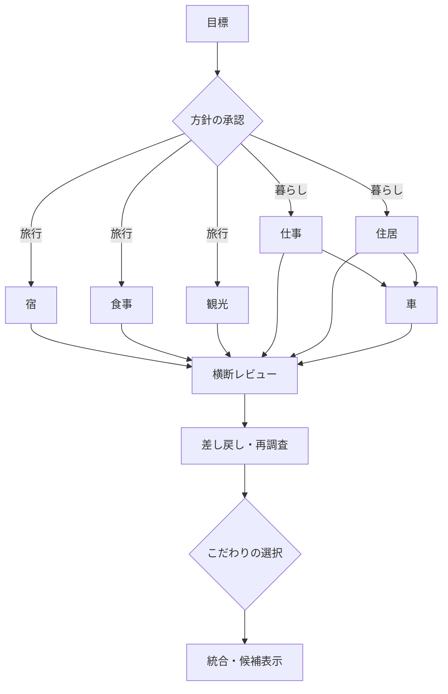

# Relay / web-harness-runtime

**目標をチームで調べ、互いに見直し、大切な選択を人に戻す自律タスク runtime。** pi coding agent、OpenRouter の無料モデル、Vercel agent-browser を使う CLI に、Grok Bot / OpenMausBot / Rakazo の公開画面を参照した会話中心の Web Mock と、self-host VM 向け NVIDIA OpenShell executor を追加しました。

## Web Mock を試す

```sh
npm ci
npm run web
# http://127.0.0.1:4310
```

API キーなしで体験できます。左の Bot 一覧、中央のチーム会話、右の Team Computer を使い、「箱根の2泊3日」と「湘南の暮らし」の2シナリオを操作できます。体験データは架空で、宿・店・求人・物件・車両の実在や価格を保証しません。独自の目標文や追加のこだわりは保存しますが、体験モードの旅程・レビューはこの2シナリオのテンプレートです。

1. 旅／暮らしの主役を、おすすめ案と代替案から選ぶ。予算やこだわりも入力。
2. 独立タスクは最大2件を並列実行。依存タスクは前提が揃うまで待つ。
3. チーム会話でレビュー指摘→担当への差し戻し→再調査を確認。
4. 温泉・夕食などのご褒美、または仕事・内見・固定費など次の一歩を選ぶ。
5. 選んだ内容に合わせたプランを見る。更新しても履歴と承認が残る。

方針変更では旧承認を再利用せず、改訂番号を上げて再計画します。現段階では影響タスク限定の差分再計画ではなく、同じ目標の全タスクを作り直します。停止後に古い処理が結果を書き戻さないことも検証しています。

UI の「実調査に切り替え」は `.env` の無料モデル枠を実際に使う操作です。実調査は数分かかり、公開サイトにアクセスできない場合もあります。体験モードとは別の明示操作にしています。


## CLI で実サイトを調べる

Node.js 22 以降が必要です。既存 `.env` は上書きしないでください。

```sh
# 初回のみ：.env がなければ作り OPENROUTER_API_KEY を記入
cp -n .env.example .env
npm run browser:install
npm run build
npm start -- doctor

npm start -- run '髪質改善で有名な渋谷の駅から近い韓国アイドル風になれるサロンを教えて欲しい'

npm start -- run '京都駅から近い和食ランチを予算3000円以内で2件比較して' \
  --url https://www.hotpepper.jp/top_party38/SA22/Y435/X434/G004/

# 複数URLの初期優先順と、モデルによる必要な情報源の選択
npm start -- run '渋谷で髪質改善と韓国風ヘアが得意なサロンを比較して' \
  --url https://www.jalan.net/ https://beauty.hotpepper.jp/ https://www.hotpepper.jp/
```

`run` の既定 URL は Hot Pepper Beauty。検索・エリア・個別詳細 URL を起点にもできます。開発時は `npm start --` の代わりに `npm run dev --`。`--max-steps`、`--max-pages`、`--timeout`、`--model`、`--json` を指定できます。

```sh
npm start -- run-file examples/beauty.json
npm start -- plan '温泉旅館を比較して' --url https://www.jalan.net/ https://beauty.hotpepper.jp/
npm start -- models
npm start -- quota # 推論を使わず、残量と次の日次リセット時刻を確認
npm start -- sources
npm start -- tasks
npm start -- show TASK_ID --json
npm start -- retry TASK_ID
```

モデルは現行 OpenRouter カタログから、無料 ID、全料金ゼロ、tools 対応、16K 以上のコンテキストを確認して選びます。`provider.max_price` もゼロに設定し、有料への fallback はしません。`OPENROUTER_MODEL` で特定の無料モデルを選べます。開始前にキー情報APIで無料残量を確認できた場合、残量0ならモデル要求を送らず次の回復時刻を返します。日次枠切れと短期の429を区別し、エラー後に同じ要求を繰り返しません。

## サービスごとの品質を確認する

```sh
npm start -- eval --list
# APIを使わず、検索一覧→個別詳細の導線だけを切り分ける
npm start -- eval --browser-only --case gourmet-kyoto-lunch --timeout 90
npm start -- eval --browser-only --case carsensor-family-sienta --timeout 90
# 無料枠回復後、自然言語から比較回答までを評価
npm start -- eval --case gourmet-kyoto-lunch --parallel 1 --timeout 360
```

5サービスの条件付きクエリは [examples/service-evals.json](examples/service-evals.json)。`--retrieval-only`（`--browser-only`と互換）で返る `mode: retrieval-only / details_read` は本文と詳細リンク取得の成功であり、自然言語回答の合格ではありません。

| サービス | 今回の実測 |
| --- | --- |
| Hot Pepper Beauty | メンテナンスを検知し、架空のサロンを回答しない動作を確認 |
| Hot Pepper グルメ | 検索一覧→ランチ詳細2件の取得成功。引用修復を改善、改善後LLM回答は再評価が必要 |
| カーセンサー | 一覧→個別車両2台の取得成功。総額・走行距離の不一致事例を確認 |
| じゃらん | 公開HTMLをWindows-31Jで解析し、箱根一覧→宿詳細2件を取得。温泉・露天風呂・アクセスの本文を確認 |
| SUUMO | 公開HTMLから検索結果本体→物件詳細2件を取得。家賃・管理費・間取り・対象駅の本文を確認 |
| Indeed | Request Blocked。回避せず、取得不可として扱う |

じゃらん・SUUMOはサーバーが公開するHTMLを優先し、他サイトや動的ページにはagent-browserを利用します。取得方式・HTTP状態・文字コードをページに記録し、公開HTMLの取得をブラウザ描画確認と混同しません。両方式とも同じ引用・候補検証を通します。

実評価中に無料日次枠（50件）を消費したため、5サービスの自然言語回答品質が合格したとはしていません。[実測レポート](docs/cli-service-validation.md) に task ID、具体的な失敗、改善、再評価手順を記録しました。引用は取得本文との一致と同一対象への対応を検証し、一覧ページや制限画面の候補化を拒否します。引用の意味と主張が一致するかには、モデルの誤りが残り得ます。

## 目標ルーターと内部A2A



旅行なら宿・食事・観光が独立し、最大2件同時実行。暮らしなら仕事と住居を並列に、車は両方の条件を確認後に実行します。前提が失敗・未確認なら依存タスクを進めません。

目標・改訂・タスク・配送・関連 ID、送信元・送信先、message kind、hop を持つ内部メッセージで引き継ぎます。メンバー確認、重複配送防止、hop上限を設けています。**外部 A2A 標準の互換実装ではありません。** 体験モードのレビューはスクリプト。実調査モードの横断レビューは未確認条件等のルール検証で、交通・料金・生活の成立性を推論する独立 LLM reviewer は未実装です。

実調査では複数の pi runtime を呼び出し、こだわり承認後に該当分野の確認済み候補があれば1回再調査します。生成した候補だけを表示し、取得できない分野を Mock で埋めません。実旅程の最適化・費用合算や予約実行は範囲外です。

```sh
npm start -- goal create --scenario travel
npm start -- goal show GOAL_ID
# show が返した gate ID、revision、choice ID を使用
npm start -- goal decide GOAL_ID --gate GATE_ID --revision 1 --choice relax
npm start -- goal list
npm start -- goal revise GOAL_ID
npm start -- goal cancel GOAL_ID
```

CLI の `goal` 操作は一つの制御プロセスで使用します。同じ保存先を複数の Web サーバーや CLI プロセスから同時に書き換える分散ロックは未実装です。Web の同一プロセス内の二重承認と競合はテストしています。

## self-host VM / OpenShell

[導入手順・ポリシー・検証状況](docs/openshell.md) を参照してください。

```sh
docker build -t web-harness-runtime:local -f infra/openshell/Dockerfile .
npm run test:image

# dry-run: VMへ接続せず、発行計画とpolicyを保存
npm start -- sandbox plan '箱根で温泉のある宿を比較して' \
  --gateway selfhost --url https://www.jalan.net/

npm start -- sandbox doctor --gateway selfhost
# 設定済みgateway/providerへ実sandboxを発行
npm start -- sandbox run '箱根で温泉のある宿を比較して' \
  --gateway selfhost --url https://www.jalan.net/
```

Web/goal router の実調査を sandbox ごとに発行する場合、ホストの `.env` に設定します。

```dotenv
RUNTIME_EXECUTOR=openshell
OPENSHELL_GATEWAY=selfhost
OPENSHELL_IMAGE=web-harness-runtime:local
OPENSHELL_PROVIDER=web-harness-openrouter
```

`src/executors.ts` が各調査を別 sandbox に割り当て、downloadした `task.json` を目標に関連付けます。実キーは gateway provider で保持し、sandbox 内は placeholder を使います。APIキーを image、task JSON、ブラウザに渡しません。control plane の承認とルールレビューはホスト側です。

Linux arm64 イメージのビルドと、秘密・ネットワークなしコンテナ内での Node/Pi/agent-browser/Chromium 起動・ページ取得を確認しました。**接続先 VM/gateway が未指定のため、実 OpenShell 発行・credential rewrite・Landlock 下での起動は未検証**です。Docker の検証を OpenShell の検証と同一視しません。sandbox は成果物回収後も retain するため、状態を確認して stop/delete する運用が必要です。

## 保存・制限

`.runtime/tasks/` にタスク、ページ本文、引用、JSONLイベント、pi会話、回答を保存。`.runtime/goals/` に目標・選択・改訂・メッセージ・プラン、`.runtime/sandbox-plans/` に発行計画と成果物を保存します。`.env` / `.runtime` / `.pi` / node_modules / dist は Git から除外し、Docker context も allowlist に制限します。

単一調査の既定は70ステップ（モデル要求＋ツール呼び出し）、12ページ、600秒。目標内の初回実調査は各50ステップ・7ページ・210秒、こだわり再調査は1回・35ステップ・5ページ・180秒です。並列上限2は目標ごとの上限で、目標を横断する分散的な同時実行制御ではありません。

単一タスクの終了コードは成功0、部分回答2、失敗・時間切れ・候補なし1、中断130。`retry` は新規調査で、元会話の途中からの再開ではありません。強制終了の途中状態は Web 再起動時に interrupted とし、再計画します。

提供ツール以外の shell/ファイル編集をモデルに渡さず、公開HTTPS・許可host・固定DOM抽出コードで閲覧します。公開HTMLの転送先もホストと公開IPを検証し、スクリプトを実行せず、本文を4MiBで制限します。サイトのCAPTCHA・ログイン・制限を回避しません。予約・購入・応募はしません。

## 検証とレビュー

```sh
npm run check
npm test
npm run build
npm run test:ui
```

UI試験は Playwright を使います。既存 Chrome/Chromium を自動検出し、なければ `npx playwright install chromium`。`PLAYWRIGHT_CHROMIUM_EXECUTABLE_PATH` も指定できます。試験では APIキーを無効にし、隔離保存先で実行します。画面画像と結果は `.runtime/ui-qa/` に出力します。GitHub Actions に型・テスト・ビルドと、APIキーなしのUX試験を設定しています。

- [検証計画](docs/verification-plan.md)
- [検証結果と残課題](docs/verification-results.md)
- [参照実装と再現対応](docs/reference-ux.md)
- [PR説明](docs/pr.md)

参照: [agent-browser](https://github.com/vercel-labs/agent-browser)、[pi SDK](https://github.com/badlogic/pi-mono/blob/main/packages/coding-agent/docs/sdk.md)、[OpenRouter無料モデル](https://openrouter.ai/docs/guides/routing/model-variants/free)、[NVIDIA OpenShell](https://github.com/NVIDIA/OpenShell)、[Grok Bot](https://x.ai/bot)、[OpenMausBot](https://github.com/milind-soni/OpenMausBot)、[Rakazo](https://github.com/elie222/rakazo)。
