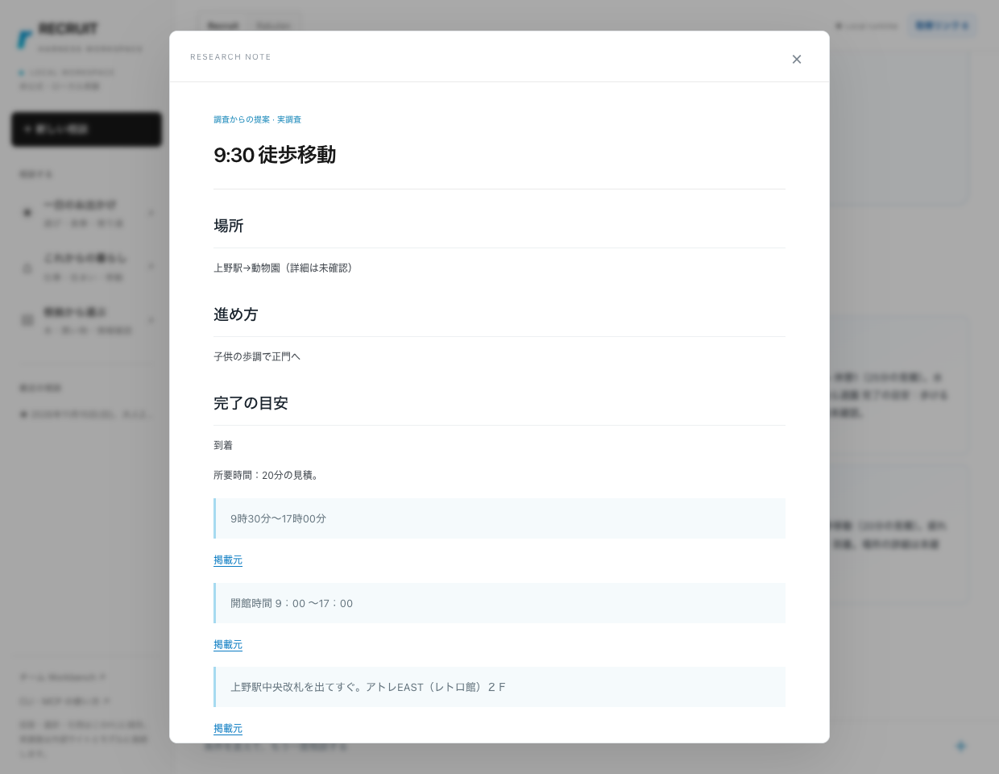

# 回答の具体性を完了条件にするruntime

2026-11-14。行程や推奨案について、時刻・金額だけを並べるのではなく、利用者が次に何をするかまで検査する仕組みを追加した。

## 実装した契約

`src/answer-plan.ts`で相談を日帰り行程・次の行動・事実確認に分ける。単なる書籍情報や宿の比較に不要な一日の行程を要求しない。行程と行動の相談では、finish_taskへactionPlanを渡す。

| 項目 | 検査・返却するもの |
| --- | --- |
| いつ | 開始時刻。日帰り行程では所要分数も必要 |
| どこで | 実施場所と、場所の詳細を出典に対応付けたか未確認か |
| 何をする | 行動の対象と操作 |
| どう進める | 「適宜」「周辺」「ゆっくり」だけで止めない具体的な進め方 |
| 終了の目安 | 観察した違いを説明、到着、会計など、その手順を終える判断 |
| 条件が変わった時 | 雨・疲労・場所を利用できない等の条件と代替行動 |
| 費用 | どの案の予算か、数量×単価、掲載額と未確認見積、合計と上限との差額 |

開始・終了の指定、重複する時間、10分を超える未説明の空白、時間枠外の移動を検出する。移動や待機を説明文へ埋め込むだけでなく、行程へ分けるよう修正を求める。

掲載単価は引用中の円表記・無料表記に対応させる。合計が内訳と一致しない場合や、未保存・改変済み引用を使った計画は拒否する。金額が引用に出現することは検査できるが、その引用が正しいプラン・適用日・年齢を意味するかの一般的な意味判定まで証明するものではない。

## 自律修正と停止

1. モデルのfinish_taskを、条件・引用・予算の完全性検査に通す。
2. 行程や行動の具体性が不足していれば、accepted=falseと不足箇所を返す。必要なら保存本文を読み直すか、許可された公開ページを追加調査して再提出する。
3. 具体性の差し戻しは最大2回。ステップが不足する場合も止め、未解消項目を付けた部分回答を保持する。引用不正などの完全性検査はこの上限でも緩和しない。
4. 時間上限や中断でも、引用検証済み草案があれば未完了と明記して保持する。未検証の草案を合格回答にはしない。
5. 構造化手順・予算・分岐はruntimeがMarkdownへ追記する。計画がJSON内にあるだけで、読める回答には含まれない状態を防ぐ。同じ回答を再検査しても本文を二重追加しない。

最大回数は新しいTask内の具体性修正数。JSON Schema、引用、元候補の保持など別の契約違反は既存の全体ステップ・時間上限で制限する。

## 自己改善・学習・表示への反映

- improveの独立診断でもactionPlanを再検査し、不足をinsufficient_specificityとして計画へ戻す。
- 既確認事項を失わず、具体的な計画だけが改善した場合も採用できる。空席などのunknownをsupportedへ変更する必要はない。
- 条件未達のまま具体性だけ合格しても、全体の完了・学習用成功例へはしない。offline経験集約もこの独立診断を経由する。
- sandboxの回収側でも計画と参照を検査し、ゲストの成功フラグを信用しない。
- Chatの行程カードは構造化した進め方と完了目安を優先。カードを押すと、その手順の詳細を直接開く。具体性が未達なら概要にも不足を表示する。

## 実生成で確認したこと

[実回答のHTML版](generated-answer.html)はCSS/JSを内包し、現在は[地図とロードマップの改善](visual-artifact-quality.md)を反映した版。オンライン時は日本の背景地図を国土地理院から取得し、オフライン時もピンと操作を残す。今後の実行でも各Taskの保存先に`answer.html`を自動保存する。保存済みTaskは`node dist/cli.js export-html <id> --out <file>`で、推論やWeb取得をせずに出力できる。

[回答全文・11手順・予算・引用](specific-generated-answer.md)と[実行記録JSON](evidence/specificity-results.json)を保存した。

入力は、上野で大人2人と5歳児1人、9:30〜17:00、家族16,000円以内、休憩2回、動物と科学、雨天代替を含む相談。

初回の実生成では、未確認の休憩場所を使えない時の切替が不足し、runtimeが2項目を差し戻した。モデルが分岐を追加して再提出した。その後の開発で、移動時間の空白と予算の対象案も検査対象に加えた。

最終版の別の実生成では、徒歩移動・観察・休憩・食事・帰路を分けた11手順、2つの分岐、掲載額と未確認枠を分けた予算を生成し、具体性検査を通過した。予算は「動物園と博物館常設の両方を含む家族3人の案」で12,080円。空席・臨時休館・休憩場所などを確約しない部分回答のまま保持している。

実出力の例：

> 9:50 動物比較（90分の見積）。公開中の近い2種類を案内で選び足を比較。完了の目安：違いを一つ言う。
>
> 11:20 休憩1（25分の見積）。水分・トイレ。席なしなら退園。完了の目安：歩けるか確認。場所の詳細は未確認。



外側のimprove実測1回は中断・キャンセルとなり、弱い回答を採用せず元の最良Taskを保持した。これを成功として数えていない。最終生成はそれとは別の実行。事実のunknownを維持して具体性だけを改善・採用するケースは、実際の共通loopを通す回帰テストで検証した。

## 検証と限界

型・ビルド、全207テスト、Chat操作、4画面サイズのUX検査を確認。修正成功、2回での停止、改変引用、掲載単価不一致、合算誤り、時間重複・空白、予算対象案の欠落、中断時の草案保持、具体性改善の採用、手順詳細の表示を含む。

これは構造・計算・引用対応の具体性検査であり、自然言語の意味や現地の実行可能性を完全に評価するものではない。休憩席など取得できない情報を具体性のために捏造しない。現在の時刻検査は同一日の行程を対象とし、複数日の計画には日付を含む検査の拡張が必要。

```sh
npm run build
npm start -- run-file .runtime/ux-study/day-out-input.json --mode auto
npm start -- improve TASK_ID --mode auto --iterations 1
node --import tsx --test --test-concurrency=1 test/*.test.ts
npm run eval:ux -- --task .runtime/specificity-study/final-generated.json --out .runtime/specificity-repeat
```
