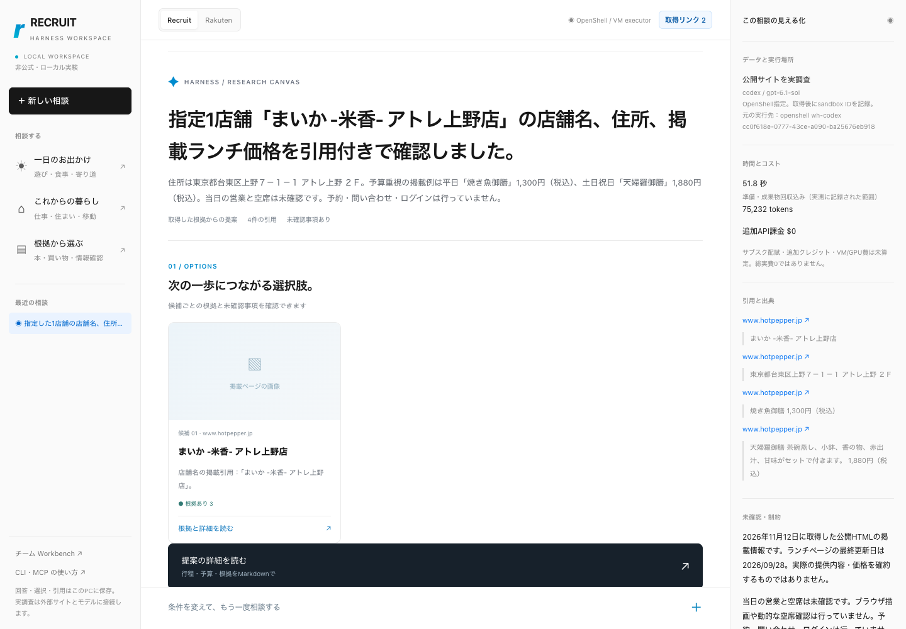
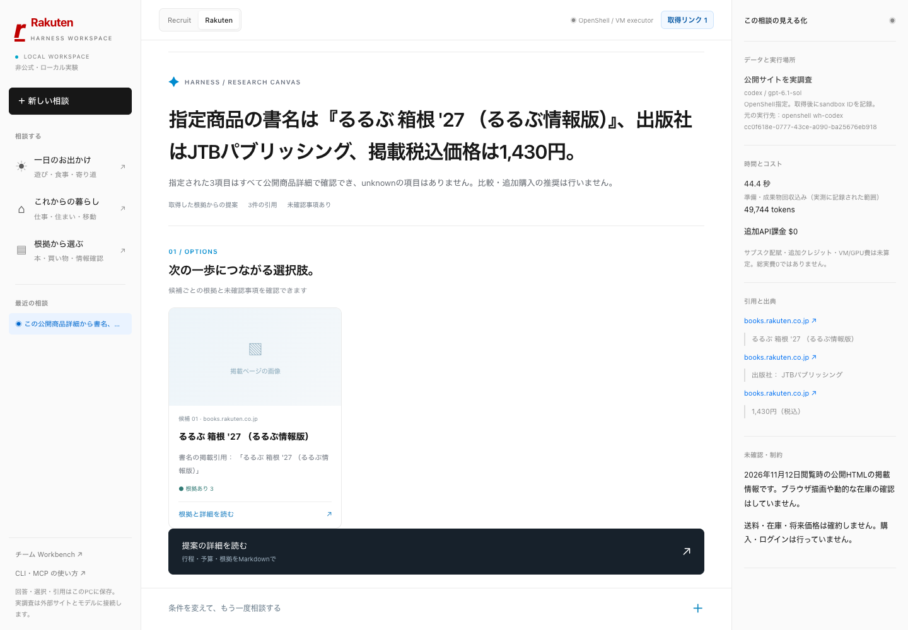

# チャットUIからの自律調査と必須検証

2026-11-13 JST。**Recruit／Rakutenとも、実際のチャットUIからAuto実調査を送信し、Codex OpenShell MicroVMでの取得・引用・回答・成果物回収、ホストの独立照合、画面への表示まで成功した。** 保存済み回答の再生やモデルのmockではない。[実測JSON](evidence/chat-runtime-results.json)。

| 画面／固定profile | 対象 | 結果 | 取得ページ | 引用 | worker起動・回収込み |
| --- | --- | --- | ---: | ---: | ---: |
| Recruit | Hot Pepper「まいか」の店舗・ランチ詳細 | succeeded | 2 | 4 | 51.836秒 |
| Rakuten | 楽天ブックス「るるぶ 箱根 '27」 | succeeded | 1 | 3 | 44.388秒 |

ここでの実測は各1ケース。全サービスやブラウザ描画の動作を保証するものではない。対象は単一利用者向けの公開HTML調査で、予約・購入・ログインは行っていない。終了後のworker停止も確認した。時間・tokensはこの試験の記録であり、性能分布やサブスク・VMを含む総費用の計測ではない。





## 確認したユーザー操作

`scripts/chat-runtime-e2e.mjs`は、新しいブラウザcontextと空の相談保存先を使い、familyごとに固定profileの実daemonへ接続する。画面テーマを変えるだけで調査済みと判定しない。

1. ブランドを選び、フォームで「実調査」「Auto」「Codex」、質問、該当サービスの公開URLを入力する。
2. 「相談をはじめる」を押して生成されたPOSTを確認する。テスト用のAPI呼び出しで相談を直接作らない。
3. SSE接続と進捗表示を確認する。
4. 回答・候補カード・Autoの判断記録を確認する。partial／blocked／failedは合格にしない。
5. 候補の詳細を開き、表示された引用を実際の保存済みevidenceと照合する。
6. 取得リンクから本文・引用を開き、保存本文内に引用があることと元URLを確認する。
7. ページを再読み込みし、回答・ブランドが復元されることを確認する。相談作成は1回だけで、再読み込みによる追加モデル実行を認めない。
8. ブラウザの未処理JavaScriptエラーがなく、taskの実行先・nonce・profile・worker停止・モデル利用tokensが揃うことを確認する。

回答表示だけでなく、引用の表示と保存内容のつながりまで必須にしている。fixture試験は同じブラウザ操作を使うが、実モデル・MicroVMの動作証明とは分けて記録する。

## 必須ゲート

| 検証 | 実行場所 | 合否 |
| --- | --- | --- |
| `npm test` | 通常CI | 190件成功。live記録がfixture・片方のみ・期限切れ・別コード・再生・local実行・引用未表示の場合のリリース拒否も検証 |
| `npm run test:chat` | 通常CI | 既存のApproval、保存済み再生、進捗、モバイル等のUI回帰検証 |
| `npm run test:chat:runtime` | 通常CIの必須step | 両familyのフォーム→回答→引用→再読み込みを固定データで検証。モデル・外部画像への依存はmockで分離 |
| `npm run test:chat:live` | OpenShellと公式CLIログインのある環境 | 両familyの実モデル・MicroVMを使うUI実測。環境未設定や取得失敗でもskipせず失敗 |
| `npm run package:cli` | リリース配布物の生成時 | 現在のコードに対する両familyのlive UI成功記録がなければ生成前に拒否 |

live記録は`.runtime/chat-runtime-live/report.json`に保存する。実測時のcompiled runtime、Web資産、設定、lockfile、テスト・ゲート・packagerのhashと結び付け、24時間で失効する。試験中にコードが変わった場合も不合格。新しい試験の失敗を過去の成功記録で隠さない。

通常のGitHub-hosted CIには利用者のログインやMicroVMがないため、CIが生成するpackageは明示的な`--preview`で`.runtime/releases/preview/`へ出力し、`unverified-preview`と記録する。fixtureの成功でverified releaseを作らない。CI stepはworkflowに追加済みで、GitHub上のブランチ保護設定自体は変更していない。

## 再実行

```sh
# CI相当：外部モデルを使わない両familyのUI検証
npm run test:chat:runtime

# 実機：Docker、ローカルOpenShell gateway、VM内Codexログインが必要
npm run sandbox:local -- preflight
npm run test:chat:live

# 型・unit・既存UI・両family fixture/live UI・配布ゲートを順に通す
npm run release:verify

# 24時間以内の、現在のコードに対応するlive成功記録が必要
npm run package:cli
```

実機試験はモデル利用枠とVMを使う。新しいGPUや外部サービスは割り当てない。remote gatewayでは`OPENSHELL_GATEWAY`等を設定し、`node --import tsx scripts/chat-runtime-e2e.mjs --live`を使う。自動的なlocal／replayへの切替は行わない。
