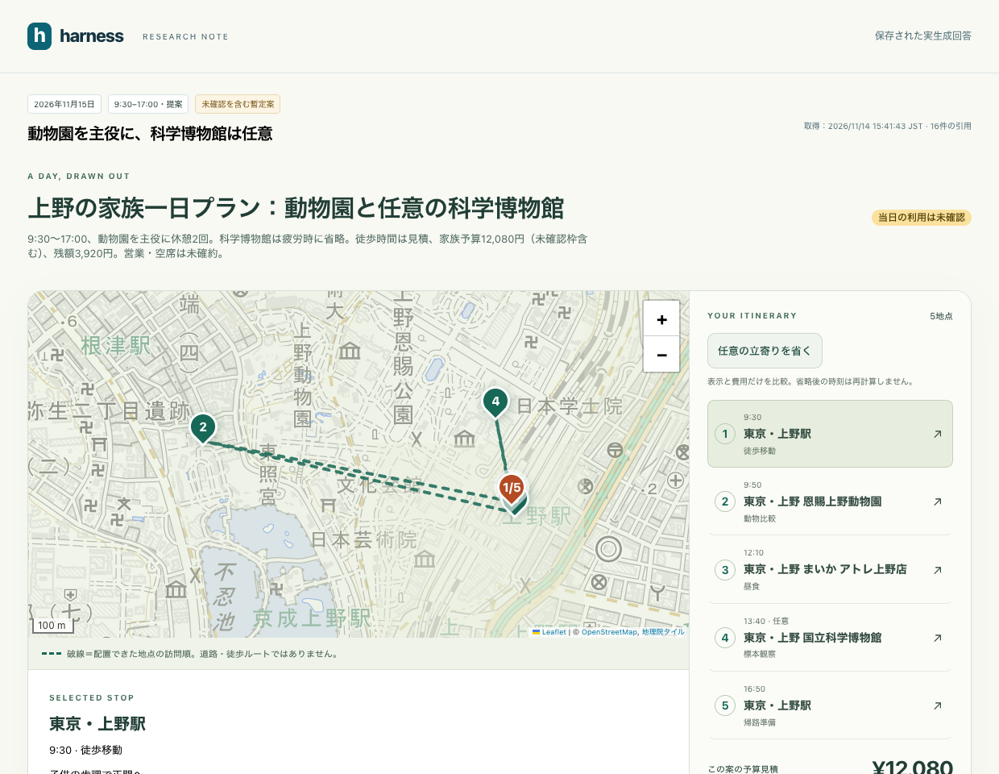
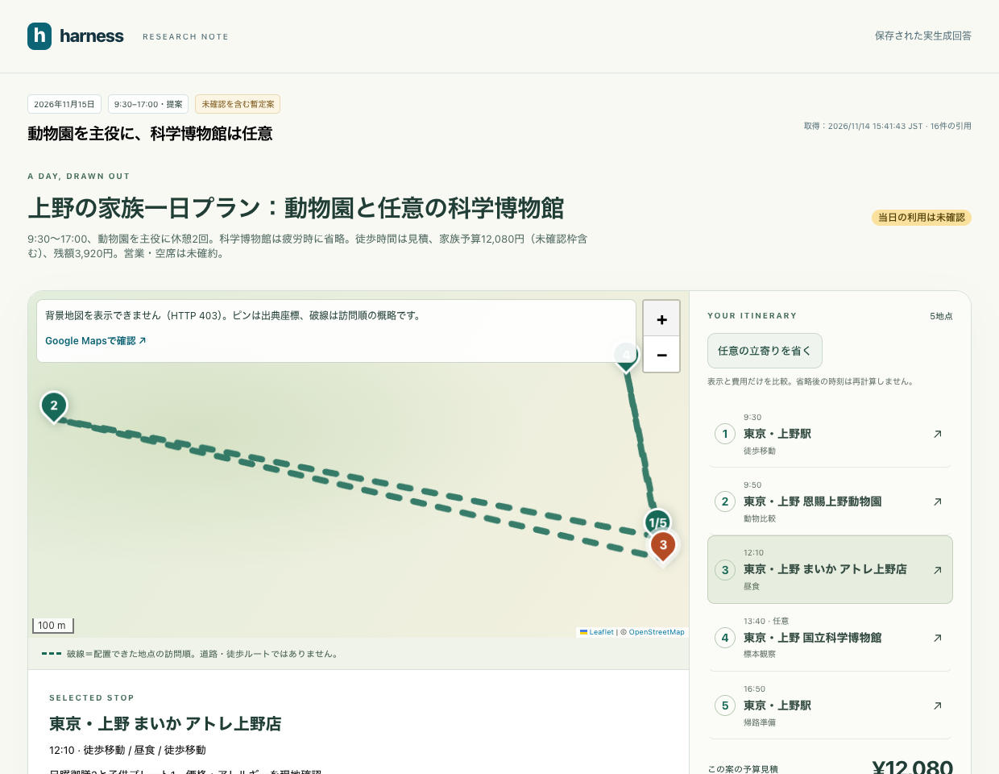

# 背景地図に403画像が並ぶ問題の修正

2026-11-15。以前のHTMLは`tile.openstreetmap.org`を画像要素で直接読み込み、画像の`load`を成功として数えていた。この方式では、HTTP 403と一緒に返された警告PNGも地図として表示される。

また、ローカルの`file://`にはHTTP Refererがない。[OSMのタイル利用方針](https://operations.osmfoundation.org/policies/tiles/)はWebページからのRefererと通常のキャッシュを要求し、headlessによるタイル走査も禁止している。今回のサーバー内部のブロック判定理由までは取得していないが、ファイル直開きと従来の公開タイルを使う自動検査は、要求条件に合わない構成だった。

## 変更

- 日本の背景は[国土地理院の淡色地図](https://maps.gsi.go.jp/development/ichiran.html)へ変更。公式説明ではアプリ・Webでリアルタイムに読み込む利用は出典明示で利用できる。CORSの`Origin: null`対応を実レスポンスとブラウザで確認した。地図内に出典リンクを表示する。
- 日本の範囲外や座標がない場合は、背景画像を取得せず概略表示とGoogle Mapsへのリンクを使う。
- `fetch`の通常CORS取得でHTTP 200、PNG形式、256×256、512KiB以下を確認してからBlob画像を表示する。不透明レスポンス、HTTPエラー、HTML、壊れた画像は画像要素へ渡さない。
- 背景の取得に失敗したら、そのレイヤーと進行中の要求を止める。同じページで自動再試行や提供元の巡回をせず、ピン・行程・Google Mapsへのリンクを残す。プロキシやReferer・User-Agentの偽装は使わない。
- CSPからOSMタイル画像の許可を削除。背景用の接続先を国土地理院へ限定し、表示は検証済みBlobを使う。地点座標の出典であるOSM/Nominatimの引用はそのまま保持する。

## 検証

[実タイルの確認記録](evidence/map-background-live.json)は、明示的な手動確認コマンド`node scripts/check-map-live.mjs`によるもの。1画面ずつ、ファイル直開きとローカルHTTPの両方で各8タイルがHTTP 200、画像デコード・出典表示が正常、OSMタイルへの要求が0件であることを確認した。

[自動ブラウザ検査](evidence/visual-artifact-qa.json)は公開タイルを使わない。合成したPNGをローカルの通信fixtureで返し、レイアウトと操作を確認する。403 PNG、429 PNG、通信/CORS拒否、PNGを装った不正本文でも、エラー画像が出ず地点を選べ、拒否後にズームしても追加要求が出ないことを検査した。CIでも同じ検査を実行する。

地図の破線は訪問順の概略であり、徒歩の道路経路ではない。背景提供元の可用性や、海外の背景地図まで保証する変更ではない。
