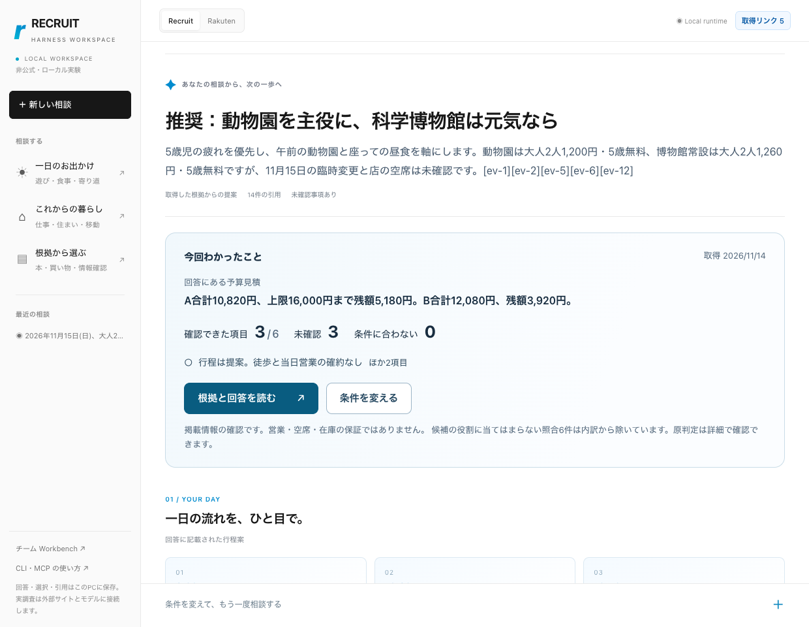
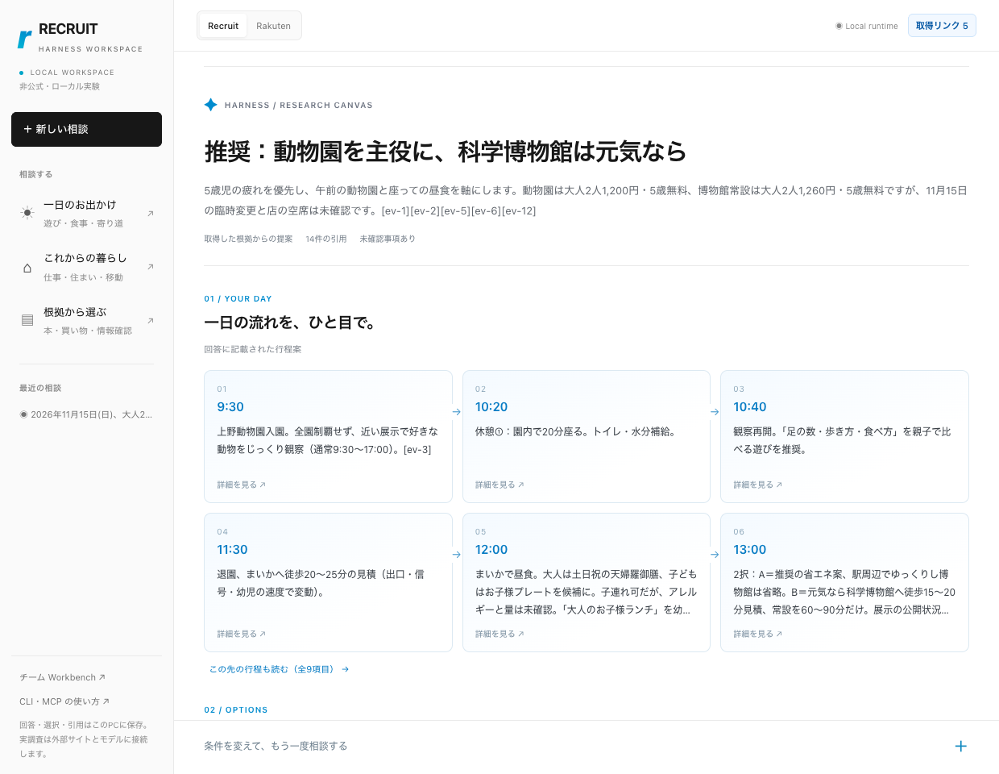
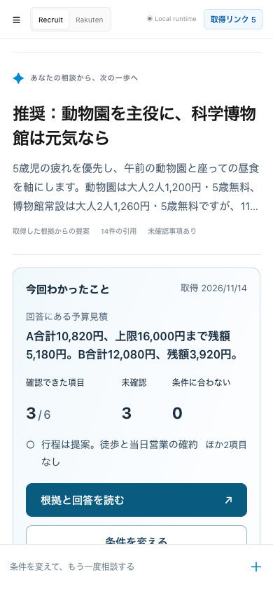

# Offlineの経験学習と、10秒で価値を伝えるUXループ

2026-11-14。現在のweb-harness-runtimeへ実装し、公開サイトを使った実生成、保存回答を使った旧新UI比較、offline手順の再利用まで確認した。

## 何を取り入れたか

[EvoHarness-RL](https://arxiv.org/html/2608.05446v1)は、状態・進捗・経験を分けてharnessの使い方を学ぶ研究。BPEと、成功を前提に効率を評価する考え方を採用した。実験はALFWorld上のモデル学習であり、その性能をWeb調査へ転用して主張しない。

今回行ったのは、検証済み履歴からの**手順のoffline集約**と、今後の方策学習に使える中間データの出力。SFT/GRPOによるモデル重みの学習は行っていない。既存Codex等のCLIログイン経路は重みの学習APIではなく、現データも独立した成功例が不足するため、重み学習は保留とした。論文の学習コード・プロンプトをそのまま製品へ組み込んだものでもない。

[Harness-as-a-Service](https://hermosaai.com/research/harness-as-a-service)は、loop・SDK・隔離・browserの責務と、状態の所有を分けて考える設計資料として採用。特定サービスへの移行はしていない。現在の保存・再起動・再実行の約束をAPIのstateSemanticsにも明示した。MCP互換だけで状態の移植や透過的復旧まで保証したとは扱わない。

| 層 | 現在の責務 | 今回の変更 |
| --- | --- | --- |
| モデル | 相談の解釈、調査、回答生成 | 短い結論→理由→行程→予算→未確認という回答形式 |
| loop | 条件固定、再調査、採否、停止 | BPEを整理し、offlineの検証済み手順を計画へ再利用 |
| 取得・隔離 | 公開URL・profile境界・executor | 既存の境界を継続。古い本文を新しい根拠へ昇格しない |
| 状態 | Task、Run、loop、atomicファイル | 学習用スナップショットとtrain/validationの分離 |
| 評価 | 引用完全性、意味判定、利用量 | データの独立性と、成功を優先する手順報酬 |
| UI | 結論、根拠、未確認、次の操作 | 最初の画面、予算見積、10秒レビューと明示的な人の評価 |

## Offlineの処理

```sh
npm run learning:build
# または
RUNTIME_DIR=.runtime/quality-study/loop-after node dist/cli.js learning build
```

1. 保存された改善loopと実行Taskを読む。凍結ベンチマーク、条件変更、参照できないTask、利用量未取得を除外する。
2. その時の取得状態（Belief）、未達・実行済みの状態（Progress）、選んだ戦略（Experience）をコンパクトな入出力へ変換する。隠れた思考過程やページ全文は学習ファイルに含めない。
3. 本文と引用を現在の検査で再検証する。モデルの成功フラグだけで成功例へしない。費用を抑えただけの失敗が、確認を終えた成功より高い報酬にならない。
4. クエリ・条件・候補のentityをまとめたSHA-256から、固定のtrain/validation割当を決める。同じ課題の再実行・親子Taskは同じ側。後からデータが増えても割当は動かない。言い換えによる意味的な重複まで検出するものではない。
5. train側の検証済み成功だけから手順を集約する。validation側は手順の再利用へ混ぜない。独立課題・成功例不足ならtrainingReadinessにそのまま記録する。
6. 次のimproveで同一クエリ・条件・候補・エンジン・モデルに一致したときだけ再利用する。元Taskのハッシュ、引用、取得可能性を再検証し、strategyと許可されたURLだけを渡す。本文と引用は新しいTaskで再取得する。

保存先は `.runtime/learning/<snapshot-id>/{manifest.json,train.jsonl,validation.jsonl}` と `experience.json`。中間データはvendorへそのまま送るSFT用messages形式ではない。trainer・人手の意味ラベル・独立したprospective評価は別途必要。

実データでは、通常の `.runtime` の履歴は学習用成功例・validationが不足し、新たな成功手順を作らなかった。楽天の再実行データでは同一課題の成功手順を作成できたが、独立課題は1群なので、ここでもモデル学習の準備完了にはしていない。

その楽天の手順を新しいimproveで実際に利用し、必須確認0→3、詳細0→1で完了。BPEと採用したsnapshot IDがloopに保存され、新しい取得日時の引用が作られた。[実測JSON](evidence/offline-ux-study.json)に記録した。これは同一課題の手順再利用の動作確認であり、未知の課題への学習効果を示す比較ではない。

## 当たり前品質基準

基準は [config/ux-quality.json](../config/ux-quality.json) に置いた。[NN/gの10秒以内の価値伝達](https://www.nngroup.com/articles/how-long-do-users-stay-on-web-pages/)を参考にした製品目標であり、全員の好みを保証する数字ではない。[WCAG 2.2](https://www.w3.org/TR/WCAG22/)を参照し、主要文字のコントラスト4.5:1と、主要操作44px以上を採用した。44pxは今回の操作目標で、WCAG AAのすべての対象に一律44pxを要求しているという説明ではない。

| 観点 | 自動検査・製品基準 | 人の10秒評価 |
| --- | --- | --- |
| 結論 | 最初の画面に短い見出しと理由。長い相談文を折り畳む | 何がわかった回答か理解できたか |
| 判断材料 | 提案中の予算は原文から表示。確認・未確認・不一致を区別 | 未確認や制約を見つけられたか |
| 次の操作 | 「根拠と回答を読む」を最初の画面に置く | 次に押す場所がわかったか |
| 待ち時間 | 保存回答の表示10秒未満、詳細を開く操作1秒未満 | 操作に迷ったり待たされたと感じないか |
| 操作性 | 主要ボタン44px以上、横スクロールなし、Escapeで閉じフォーカス復帰 | 無理なく操作できたか |
| 見た目 | 余白、文字階層、コントラスト、4つの画面サイズを検査 | 魅力を1〜5で明示評価。目標中央値4以上 |
| 正直さ | 元の引用と判定を保持。過去の回答・口コミ評点を信頼度へ転用しない | 信頼できる表示だと感じたか |

自動検査の画面サイズは320×568、390×844、768×1024、1240×960。小さな画面では、詳細な内訳より操作と重要な未確認を先に配置する。施設に飲食店の条件を当てる等、保存回答が明示的に役割外とした照合は概要内訳から分け、件数と理由を明示する。元のunknownや判定は書き換えない。

10秒は「保存回答の表示・理解」と「長い実調査の進捗が分かること」の目標。複数サイトを読む実モデルの回答完了を10秒と保証していない。

## UXの改善ループ

1. 公開ページを使った実生成Taskを保存する。
2. 同じTaskを旧UIと新UIへ表示し、内容を変えずに画面・表示時間・操作・引用・フォーカスを検査する。
3. スクリーンショットを見て、視線の順序、予算と不確実性の見え方を修正する。今回は長い本文・見積の見えにくさ・役割外条件の混在を修正した。
4. 実調査の回答末尾の「この画面を10秒でレビュー」を押すと、回答を10秒表示してからレビューを開く。別タブに移った計測は無効にする。選択肢や評点は事前選択しない。
5. 明示的な人の回答は `ux-feedback` へ追記し、過去のレビューを上書きしない。`node dist/cli.js ux-reviews` で集計する。反復回答や独立レビュアーの本人性は検証できないので、件数だけで人の独立評価完了にはしない。
6. 目標は独立した5人以上、理解・未確認・次の操作の各80%以上、魅力の中央値4/5以上。未達なら原因を取り出し、同じ課題と別課題で修正後に再評価する。魅力の点数を事実の正しさや学習の成功報酬へ混ぜない。

現在は自動ゲート合格、人の回答0件。ブラウザによるレビュー画面の動作確認を、人の魅力評価へ計上していない。目標達成や満足度向上を主張するには、これから実際の人の回答が必要。

## 実際に生成した回答

全文は **[生成回答・行程・予算・出典](ux-generated-answer.md)**。2026-11-14に公開ページ5件を取得し、gpt-6.1-solで生成。取得時間・費用・Task IDは[実測JSON](evidence/offline-ux-study.json)。人が代筆した理想回答ではない。通常営業・掲載価格と、当日の営業・空席・実費の確約は分けている。

> 推奨：動物園を主役に、科学博物館は元気なら
>
> A合計10,820円、上限16,000円まで残額5,180円。B合計12,080円、残額3,920円。

この費用は、家族の交通・おやつ等の未確認予算枠5,000円を含む生成案の見積。Aは動物園と昼食、Bはさらに博物館常設を加える。空席・臨時休館・アレルギー等は未確認として返した。実行結果はpartialを維持した。



| 同じ回答の旧画面 | 新画面・スマートフォン |
| --- | --- |
|  |  |

画面の評価中は外部画像を取得せず、回答本体を検査した。写真や回答を差し替えて見栄えを作っていない。生成後の保存データを表示する試験であり、スクリーンショット撮影時に再推論したという意味ではない。

旧UIにも結論と未確認の表示はあった。改善は、それを消して作り直したことではなく、予算と具体的な注意点を整理し、根拠へ進む主要ボタンを最初の画面に置いたこと。DOM上の同じ役割の要素を対応させて比較し、新旧でテスト用属性の有無を取り違えないようにした。

## 再実行と限界

```sh
npm run learning:build
node dist/cli.js ux-reviews
npm run eval:ux -- \
  --task .runtime/ux-study/generated-final.json \
  --before-web .runtime/ux-study/before-web \
  --out .runtime/ux-loop-repeat
node --import tsx --test --test-concurrency=1 test/*.test.ts
npm run test:chat
npm run test:chat:runtime
```

以前からある子プロセス起動READYの検査は、並列の全件実行でタイミング失敗が出たため、全件直列でも確認した。中断中にタイムアウトした生成試行も保存し、最終成功のようには扱っていない。最終の実生成はpartial、引用検査に合格した情報だけを保持する。

残る課題は、人の意味ラベルと独立した成功課題の追加、役割別条件の非適用をデータモデルで明示する設計、未知課題での手順評価、実際の人の10秒評価。今のoffline集約をモデルの学習済み能力や未知課題の成功率向上と読み替えない。
