# 画面・出力・構成ガイド

このガイドは、実際のChat UIで「何を入力し、何が返り、どこを押すと根拠が見えるか」を説明します。[起動・環境変数・CLI/MCPの設定はREADME](../README.md)を参照してください。

掲載画像は、個人の履歴・認証を読み込まない一時環境で実アプリを撮影したものです。回答には同梱の公開調査結果を再生し、新しいモデル推論は実行していません。写真・Web画面は撮影時に公開ページから別途取得しています。撮影日時・サイズ・SHA-256は[画像manifest](screenshots/chat-manifest.json)、元の回答・計測値は[実測JSON](evidence/delivery-results.json)にあります。

## 1. 最初の画面：相談の条件を決める

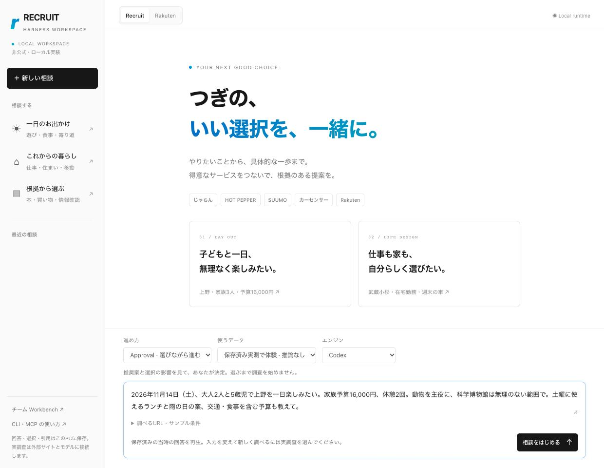

| 場所 | 操作・表示 |
| --- | --- |
| 左側 | サンプル相談、新規相談、保存済みの履歴。旅行・暮らし・本の確認から試せる |
| 中央 | 相談、調査の進捗、方針の選択、図解回答、取得リンクを表示 |
| 下側 | 質問、公開URL、Auto/Approval、保存済み実測/実調査、エンジンを選ぶ |
| 上側 | Recruit/Rakutenのテーマ切替、実行先の設定、取得リンクへの移動 |
| 幅の広い画面の右側 | 出典・未確認事項・時間・トークン・費用・実行場所。掲載画像の1240px幅では折り畳まれる |

「保存済み実測」は当時の回答を再生します。自由に変更した質問に新しく回答する場合は「実調査」を選びます。テーマの切替で調査先は変わらず、入力URLから情報源を選びます。

最初に試す相談の例：

> 大人2人と5歳児で上野を一日楽しみたい。家族で16,000円以内。動物を主役に、休憩2回と雨の日の案も考えて。

画面のサンプルは、2026年11月14日を対象にした保存済み実測です。[実調査用の詳しい条件](../examples/recruit-day-out.json)には、年齢別料金、土曜ランチ、移動時間、未確認予算枠を分ける指示も含まれます。料金・営業・空席は現時点の保証ではありません。

## 2. Approval：大切な選択を自分で決める

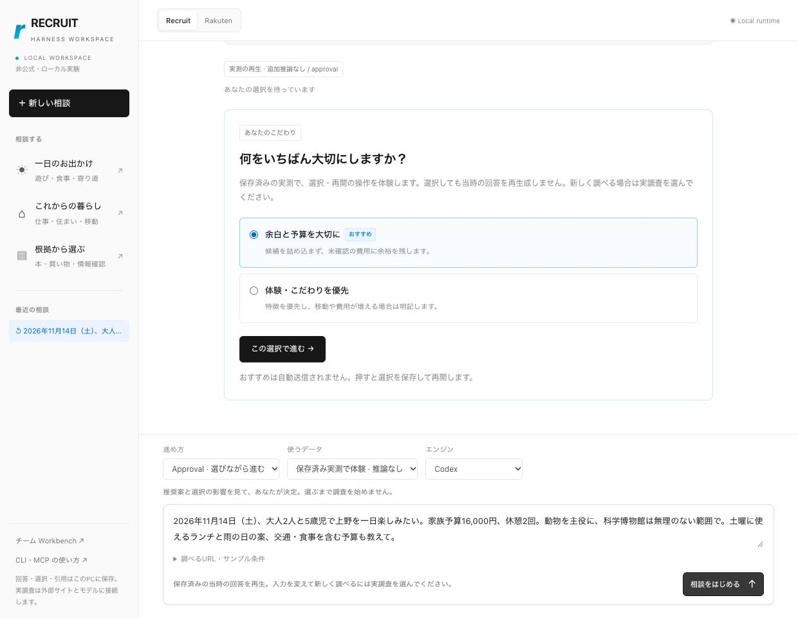

調査前には「余白と予算を大切に」「体験・こだわりを優先」のように、推奨案・別案・影響を提示します。おすすめに印があっても承認は自動送信されません。「この選択で進む」で決定を保存して進みます。

実調査後に未確認が残る場合は、次の選択が返ります。

| 選択 | その後 |
| --- | --- |
| 未確認を明記して受け取る | 未確認を残した部分回答として受領。新しい推論を行わない |
| 同じ条件で追加調査 | 同一候補の不足を追加確認。モデル利用枠を使い、条件が埋まらない場合もある |
| 同一候補の公開URLを追加 | 子ページ等の公開詳細URLを追加して確認。別候補への無断置換ではない |

Autoではruntimeが推奨方針を選び、承認待ちを作りません。未確認をすべて成功へ変換するモードではありません。

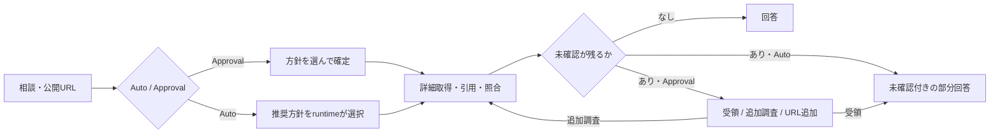

## 3. 調査中：実際に行った処理が順番に届く

実調査の進捗は「準備 → 条件整理 → ページ取得 → 根拠確認 → 回答」のステージ、取得記録数、引用数、経過時間、URL付きのイベントで表示します。サーバーからSSEで現在の相談状態が届きます。取得リンクのカードは回答の完成前から開けます。

ここで配信しているのは実行イベントです。モデルの内部思考や、回答本文を1トークンずつ表示するストリームではありません。未実行のステージを完了扱いにせず、取得できないページは失敗として表示します。保存済み実測には実調査の進捗を擬似生成しません。

## 4. 回答：まず全体像を見渡す

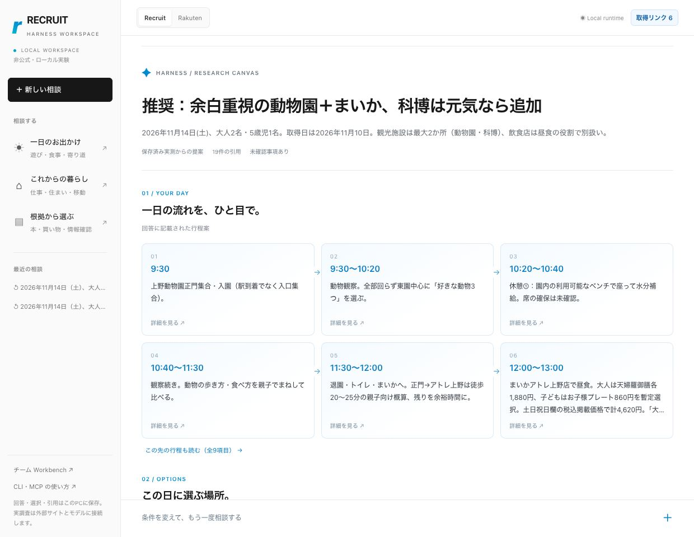

この例では、元の回答の時刻から行程カードを構成しています。

| 時間の例 | 提案の内容 |
| --- | --- |
| 9:30 | 上野動物園の入口に集合 |
| 9:30〜10:20 | 東園を中心に、好きな動物を選んで観察 |
| 10:20〜10:40 | 休憩。ベンチの確保は未確認 |
| 11:30〜12:00 | 退園・トイレ・昼食先への移動。徒歩時間は概算 |
| 12:00〜13:00 | まいかアトレ上野店で昼食。食事の販売状況等は未確認 |
| 14:00以降 | 疲れたら早めに帰る案、元気なら科博を追加する案。詳細ノートに両方を残す |

カードの矢印は回答に記載された順序を示し、経路の実測や自動最適化を示すものではありません。図解のために新しい推薦を推論せず、元の回答・候補・照合結果から表示します。長い説明は一部省略されるので、クリックして詳細を確認します。

### 写真付き候補で比較する

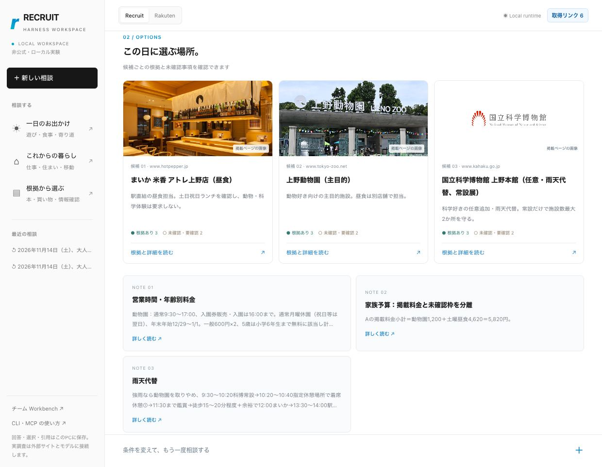

候補カードには名前・掲載画像・採用理由の抜粋・条件の照合状況を表示します。「根拠あり」と「未確認・要確認」を分けます。画像は掲載元から取得できたものだけを使い、見つからない候補には画像がないことを表示します。画像やロゴがあることは、希望条件の適合・空席・在庫の証明にはなりません。

住居・仕事・車の相談でも、同じ候補カードから条件別の根拠を確認できます。時刻付きの行程がない回答では時間軸を作らず、候補・テーマ別ノートを表示します。

## 5. 詳細：Markdownでゆっくり読む

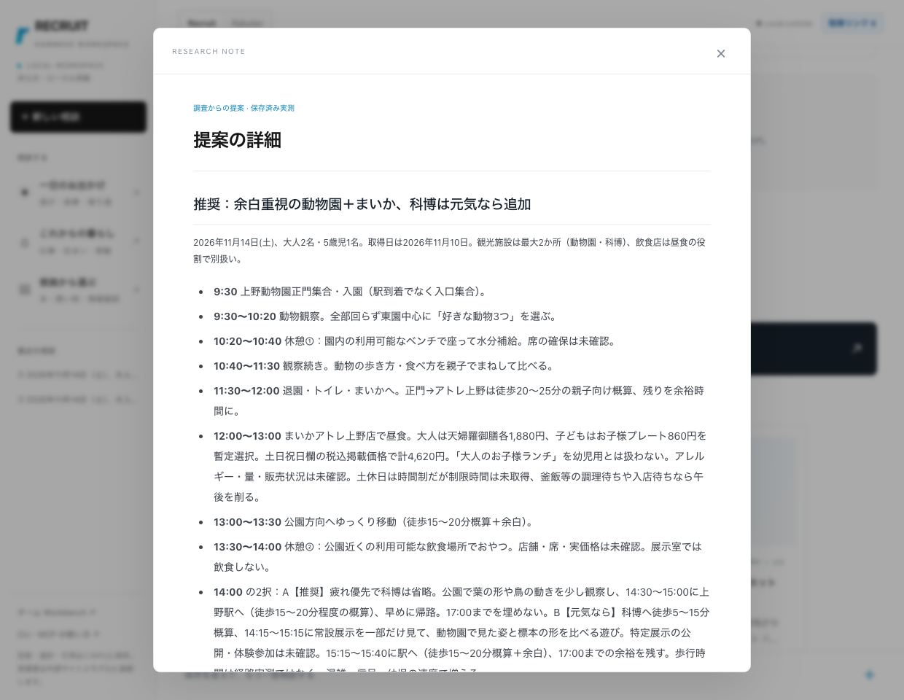

「提案の詳細を読む」で全体、「行程カード」で行程を含む回答、「候補カード」で対象の評価条件・確認結果・引用、「予算」「雨天代替」等のテーマから該当部分を開きます。

見出し、箇条書き、強調、表、引用、コードブロック、出典リンクを整形して表示します。元のテキストに含まれたHTMLやスクリプトは実行しません。回答コピーではMarkdownを利用でき、JSONリンクでは機械可読の実行記録を確認できます。

上野の実測では、掲載料金と予算枠を次のように分けています。

| 項目 | 実測回答内の扱い |
| --- | --- |
| 動物園の通常家族料金 | 1,200円（大人2名、5歳児の通常料金区分） |
| 土曜の掲載昼食価格の組合せ | 4,620円 |
| 掲載料金の小計 | 5,820円 |
| 交通・おやつ・追加飲料等 | 未確認の予算枠として5,000円 |
| 基本案の合計見積 | 10,820円。予算16,000円との差は5,180円 |

これは当時の回答に含まれる暫定見積です。追加注文・空席・臨時休業・販売状況・家族への適合など、未確認事項は詳細にも残します。実際の決済金額や予約成立を示しません。

### 元の調査の実行記録

同じ例の[保存済み実測](evidence/delivery-results.json)には、次の結果が残っています。撮影時の再生や画面操作の時間・費用ではありません。

| 項目 | 元の実測値 |
| --- | --- |
| 調査エンジン・実行先 | Codex / OpenShellの専用MicroVM |
| 返却状態 | Taskは`partial`、Autoの相談は未確認付きで受領する`completed_partial` |
| 取得記録・引用 | 6ページ、19件の引用 |
| 準備・回収・停止を含む時間 | 187.434秒 |
| トークン | 203,534（記録された累計） |
| 追加API課金 | $0。契約料金の配賦、追加クレジット、VM/GPU費は未算定 |

## 6. 取得リンク：画像・Web画面・本文を切り替える

上部の「取得リンク」から一覧に移動し、カードの「プレビューを開く」を押します。掲載元そのものを操作したい場合は「元のページ」を開きます。

### ページ画像

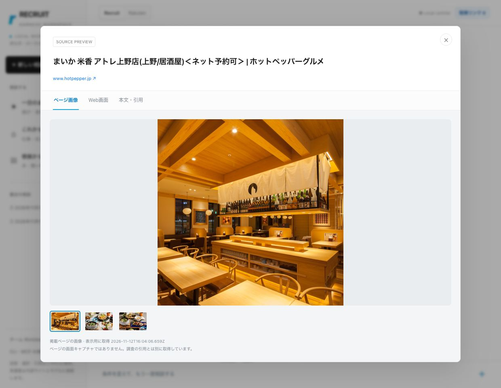

公開HTMLの画像情報から、表示できる写真等を取得します。複数画像があればサムネイルで切り替えられます。このタブはページの画面キャプチャではありません。

### Web画面

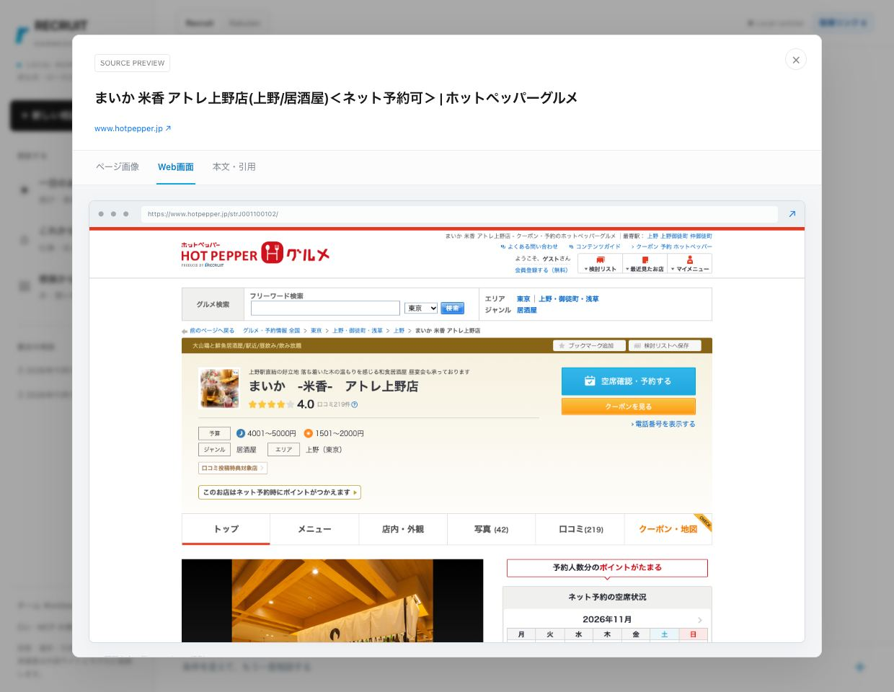

agent-browserで元の公開ページを表示し、1280×900の画面を撮影します。プレビュー内に表示するのは保存した画像なので、予約ボタン等は操作できません。日時・表示URLを確認して、必要なら掲載元へ移動します。

### 本文・引用

調査時に保存した本文と、回答に使った引用を表示します。再生データに全文が含まれない場合は「抜粋」と明記します。写真・Web画面は表示用に後から取得するため、調査本文の取得日時と別です。後から撮影した在庫・営業時間等を、元の回答で確認済みだったことにはしません。

| 表示 | 取得する場所 | 回答の根拠への影響 |
| --- | --- | --- |
| 本文・引用 | 調査タスクの保存データ | 調査時点の根拠を表示 |
| ページ画像 | ローカルChatの表示用取得処理 | 根拠を更新しない |
| Web画面 | ローカルChatのagent-browser | 根拠を更新しない |

取得失敗は画像・Web画面の代わりに明示します。無関係な写真で補ったり、制限画面を成功扱いにしたりしません。

## 7. スマートフォン

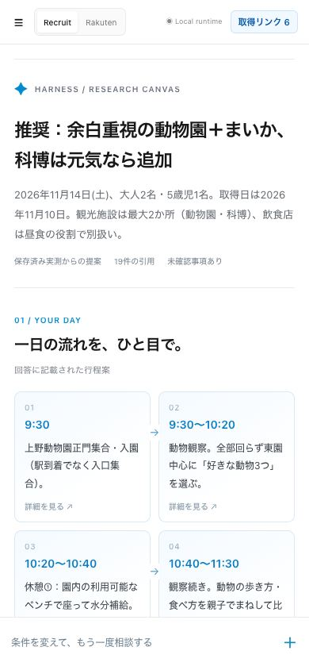

左上のメニューからサンプル・履歴へ移動します。図解の列数は画面幅に合わせて変わり、詳細ノートとプレビューはダイアログで開きます。回答後の入力欄は「条件を変えて、もう一度相談する」で展開します。

<a id="architecture"></a>

## 8. 全体構成：画面・CLI・MCPが何を共有するか

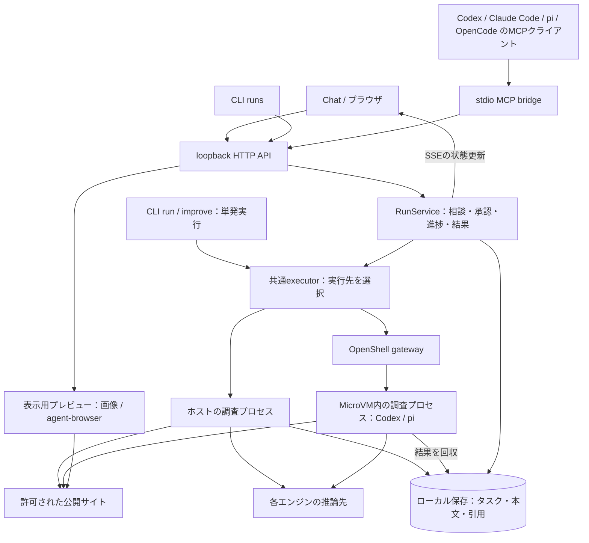

- **Chat・`runs`・MCP**：同じdaemonのRunServiceを操作します。同じ相談ID、承認、結果、履歴を使います。MCPクライアントを終了してもdaemon側の調査は続きます。
- **単発の`run`・`improve`**：共通executorを直接使います。daemon上の相談とは別で、Task IDから取得結果を確認します。
- **local / openshell**：調査プロセスの実行場所です。OpenShellを選んだのに未接続なら、黙ってホストで実行しません。
- **Codex worker**：VM内の本人ログインを保持して直列で再利用し、調査後にstopします。piの調査ごとのsandbox発行とは分離単位が違います。
- **Claude Code / OpenCode**：現在の調査プロセスはlocal。4種類のエージェントはいずれもMCPクライアントとしてdaemonへ接続できます。
- **表示用プレビュー**：調査結果に含まれるURLだけを対象に、ホスト側で画像・画面を取得します。MicroVM内での新しい推論ではありません。

### 1回の調査の中身

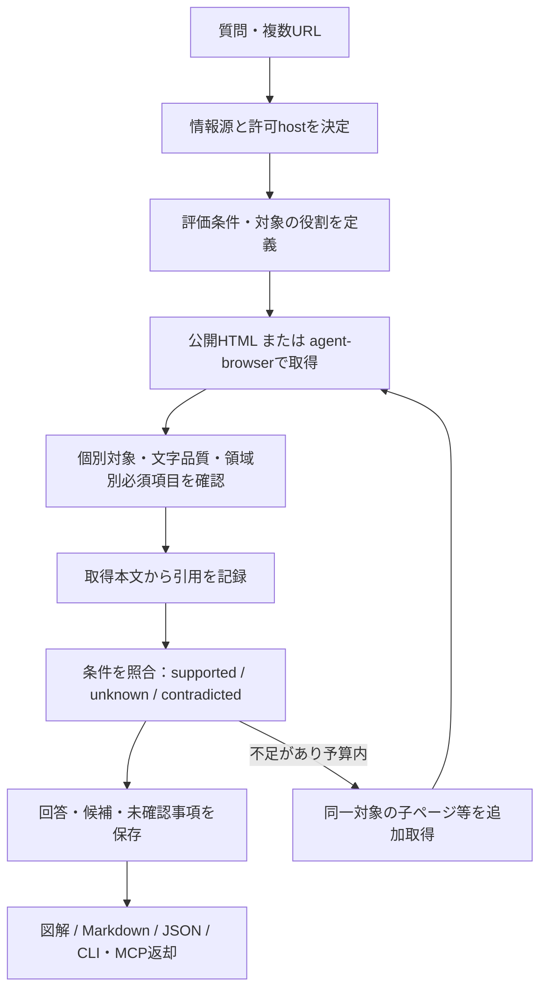

CLIの自己改善ループは、初回タスクの不足を診断して再計画・子タスク実行・独立検証を行います。回数・時間の上限を持ち、未達が埋まらなければ部分回答を保持します。条件の無断変更や、常に未達ゼロにする処理ではありません。

trustedは詳細取得の確認と情報量レベルを持つ台帳です。サイト全体の信用や、ページ内の命令を信頼する意味ではありません。外部A2A標準への対応、複数独立LLMによるレビュー、予約実行、MicroVM内ChromiumのDOM取得などの制約は[README](../README.md)と[実測結果](delivery-results.md)を参照してください。

## 9. 返却データと保存場所

| データ | 主な内容 | 用途 |
| --- | --- | --- |
| Run | `status`, `input`, `gate`, `revision`, `decisions`, `activities`, `artifacts`, `task` | Chat / CLI runs / MCPで共有する相談の状態 |
| Task | `sources`, `criteria`, `pages`, `evidence`, `answer`, `metrics`, `execution` | 1回の調査の根拠・回答・実行記録 |
| Answer | `summary`, `candidates`, `limitations` | 本文、候補の評価、未確認事項 |
| Artifact | `url`, `title`, `preview`, `capturedAt`, `method`, `state`等 | 実際に取得したリンクや失敗した試行の表示 |
| Visual | 画像ファイル、画面キャプチャ、別の取得日時 | 出典を見やすくする表示用データ |

### CLI / MCPから見た出力のイメージ

次は`show TASK_ID --json`等で確認するTaskの構造例です。値は上野の実測から抜粋し、ID、長い本文、他のフィールドを省いています。Chat / `runs get` / MCPの`harness_get`では、これを`task`に含むRunと、`gate`・`revision`・`artifacts`等を返します。

```json
{
  "status": "partial",
  "agent": "codex",
  "model": "gpt-6.1-sol",
  "metrics": {
    "tokens": {
      "totalTokens": 203534
    }
  },
  "execution": {
    "target": "openshell",
    "elapsedMs": 187434,
    "cleanupStatus": "stopped"
  }
}
```

`completed_partial`は相談を未確認付きで返した状態です。Task自体の`partial`と役割が異なります。`needs_input`は承認待ち、`failed`は調査失敗、`interrupted`はdaemonの再起動等による中断です。

```text
.runtime/
  runs/          相談・方針・承認・進捗・回答への関連付け
  tasks/         各調査の本文・引用・候補・回答・イベント
  visuals/       表示用の掲載画像・画面キャプチャ
  goals/         Workbenchの目標・内部メッセージ・計画
  improvements/ 自己改善の診断・子タスク・選択履歴
  clients/       生成した各エージェント向けMCP設定
  releases/      ローカル生成のCLI配布物
```

設定・VMの状態など他のディレクトリも生成します。実際の`.runtime/`には個人の相談や認証に関わる状態が入り得るため、共有用データではありません。

### コードの対応箇所

| 役割 | ファイル |
| --- | --- |
| ChatのUI | [`web/chat.html`](../web/chat.html)、[`web/chat.js`](../web/chat.js)、[`web/chat.css`](../web/chat.css) |
| 図解の表示用データ・安全なMarkdown | [`web/presentation.js`](../web/presentation.js) |
| HTTP / SSE / 画像配信 | [`src/server.ts`](../src/server.ts) |
| 相談・承認・再生・状態保存 | [`src/run-service.ts`](../src/run-service.ts) |
| モデルと調査ツールの実行 | [`src/runtime.ts`](../src/runtime.ts) |
| local / OpenShellへの割当 | [`src/executors.ts`](../src/executors.ts)、[`src/codex-sandbox.ts`](../src/codex-sandbox.ts) |
| 掲載画像・Web画面の保存 | [`src/visual-preview.ts`](../src/visual-preview.ts) |
| CLI / MCP | [`src/cli.ts`](../src/cli.ts)、[`src/public-mcp.ts`](../src/public-mcp.ts) |
| Workbenchの目標ルーター・内部A2A | [`src/goals.ts`](../src/goals.ts) |

## 10. 画像を更新する

```sh
npm ci
# 既存Chrome/Chromiumがなければ
npx playwright install chromium
npm run docs:screenshots
```

`docs/screenshots/chat-*.jpg`と`chat-manifest.json`を更新します。独立した一時保存先と同梱の公開実測だけを使い、モデル実行を拒否するexecutorを使います。画像・Web画面の撮影には公開サイトへの通信とagent-browserが必要です。外部サイトの状態により失敗する場合があり、失敗を撮影成功として埋めません。

公開前に画像を目視し、`npm run release:check`で追跡ファイルを検査します。撮影スクリプトは1枚250KiB未満・8枚合計1MiB未満を確認します。今回の画像はUIの1240px / 390px表示で、個人の相談履歴や認証画面は使っていません。
