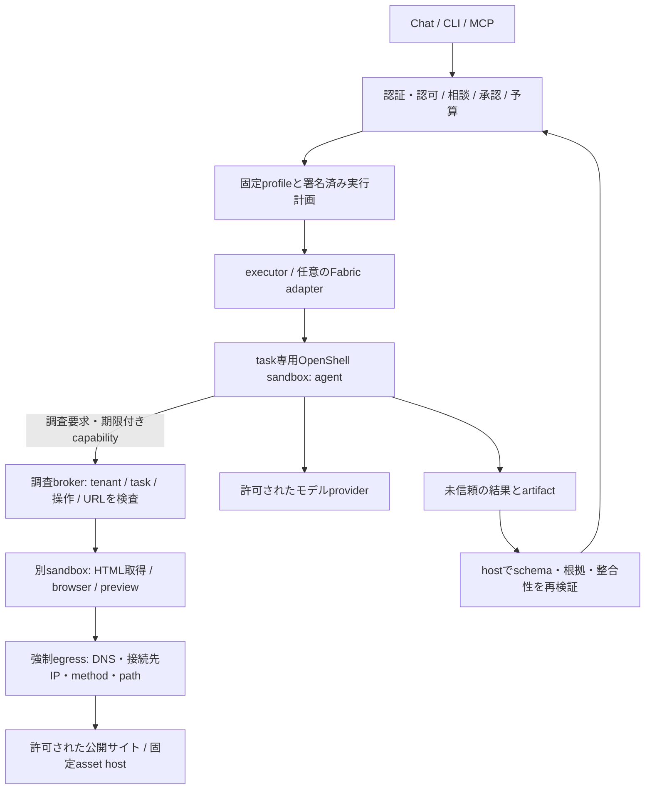

# Recruit／Rakuten runtime の境界強化と構築方針

調査・実装日：2026-11-13 JST。ソース、既存の実測記録、NVIDIA公式資料を照合した設計判断。今回、単一利用者向けの公開HTML調査を対象に固定profile、接続時IP固定、取得制限、成果物再検証を実装した。[実装・検証結果](security-boundary-results.md)を現在の完了範囲とし、共有サービス向けの構成案は後続の設計として区別する。

## 判断

**公開情報の発見・取得・引用・比較を行うRecruit runtime／Rakuten runtimeは、境界を強化した上で構築できる。** 共通の調査基盤にサービス別の固定プロファイルを載せる構成を推奨する。現在は別々の製品runtimeがあるのではなく、`src/sources.ts` のサービス別adapterと、共通executor・検証器がある。

一方、現状のまま不特定の企業・利用者を収容するサービスにする判断はできない。ホスト上のプレビュー通信、Codexの認証付きworker再利用、Codex native認証・推論endpointのTLS透過許可が残る。ログインしての在庫照会、予約、購入、応募、問い合わせは別の権限・認証・操作確定の設計が必要で、今回の成立判定に含めない。

境界を狭くすると一部の動的表示や外部CDNが使えなくなるが、公開HTMLによる比較と、取得できない条件をunknown／blockedとして返す機能は維持できる。サイトが403やCAPTCHAを返す問題と、runtimeの権限不足を区別し、前者をネットワーク許可の拡大で解決しない。

## NVIDIA製品の位置づけ

| 製品 | 公式資料で確認した役割 | 本リポジトリへの判断 |
| --- | --- | --- |
| OpenShell | sandbox外からネットワーク・ファイル・プロセス・provider資格情報を制御 | 既存executorを強化する実行境界として継続採用 |
| NemoClaw | OpenShellと対応agentをblueprint・設定・ライフサイクルで組み合わせるreference stack | 運用と設定の参考。現在のruntime全体を移植する前提にはしない |
| NeMo Fabric | harness／custom agentの設定、plan、実行、結果、artifact、telemetryの共通契約 | engine切替と評価連携の追加層。OS隔離や業務権限の強制はOpenShellとbrokerが担う |

資料：[OpenShell v0.1.7 security](https://docs.nvidia.com/openshell/v0.1.7/security/best-practices)、[NemoClaw architecture](https://docs.nvidia.com/nemoclaw/user-guide/deepagents/about/how-it-works)、[Fabric overview](https://docs.nvidia.com/nemo/fabric/latest/about-nemo-fabric/overview)。

リポジトリのOpenShell契約はv0.1.7。調査時の公式ドキュメントはlatestをv0.1.8と案内しているため、`docs/openshell.md` の「11/10時点latest」と区別する。Fabricの公式latestはv0.6.1、adapter契約は`fabric.adapter/v1alpha2`。latest追従で本番構成を変えず、CLI・gateway・schema・image digestを組にして固定する。Fabricの機能はこのリポジトリへ未導入で、採用時は固定版で再検証する。[OpenShellの版表示](https://docs.nvidia.com/openshell/v0.1.7/security/best-practices)、[Fabric adapter contract](https://docs.nvidia.com/nemo/fabric/latest/adapter-contract/overview)。

## 実装後の境界と残る制約

| 境界 | 現在のコード／挙動 | 評価・必要な変更 |
| --- | --- | --- |
| 実行場所 | `executors.ts` はlocalが既定、OpenShell指定失敗時はlocalへfallbackしない | 公開サービスではlocalを起動時に拒否。開発用設定と分ける |
| 制御plane | `server.ts` はloopback bind、Host／Origin検査。`goals.ts` 等が相談・承認を管理 | 単一利用者向け。ローカル他プロセスの認可やtenant認証の代替にはならない |
| agentツール | `runtime.ts` の固定調査ツール。Codex側もshell等を無効化 | 維持。promptだけに依存せずbrokerで要求ごとに検査 |
| URL | `sources.ts` がHTTPS・443・userinfoなし・IP literalなし・完全一致hostを検査 | `allowedHosts` は登録adapterの関連hostまで展開する。入力hostだけの権限とは異なる |
| DNS／IP | 全回答検査と接続時IP固定。redirect毎に検査 | direct HTTPSの再解決競合を解消。管理されたOpenShell経路は合成DNSをrelayとして扱い、gatewayのpublic CIDR制約で実接続先を制限 |
| site通信 | 強化モードは固定pathのGET／HEAD、REST enforce、public CIDR。developmentは従来のTLS透過 | 強化policyのVM実機検証は結果資料の状態を参照 |
| binary | 強化モードではNodeのみresearch通信を許可。Chromium描画を提供しない | binary制約だけをtool単位の権限と解釈しない。完全なプロセス分離は後続 |
| ファイル | Landlock hard requirement、uid/gid 1000、複数の書込領域 | `/sandbox`、`/workspace`、`/tmp`、`/home/node`を広く許可。task別の読書き分離は不足 |
| pi資格情報 | gateway providerのplaceholderとendpoint binding | 良い境界。実際のeffective policyとprovider profileを検証し、agentへ実キーを渡さない |
| Codex資格情報 | `codex-sandbox.ts`／`codex-worker.ts` の保持diskにログイン。workerをleaseで直列利用 | 同一アカウントでの運用。leaseは過去タスクのファイル・認証を隔離しない |
| 結果の取込 | request、nonce、task ID、profile、予算、schemaを照合。引用と詳細判定を再計算し、引用元を独立取得 | guestの本文と引用の同時偽造も独立取得本文との不一致で拒否。metricsは形式検査したguest申告値 |
| 表示プレビュー | 固定asset host、redirect毎の検査、接続時IP固定。強化モードは画面描画停止 | ホスト取得は残る。共有サービス化では別workerへ隔離 |
| 外部コンテンツ | ページ本文を引用・条件検査に使う | HTML除去だけではprompt injectionを防げない。外部内容から権限、承認、profileを作らせない |
| 停止 | task停止、sandbox stop、停止不明の記録 | 通信断でremote停止を断定しない設計を維持し、外部TTL／回収処理を追加 |

これらはコードの静的評価。sandbox脱出、資格情報流出、DNS rebinding攻撃が実環境で成功することを今回実証したものではない。

## Recruit／Rakutenの成立範囲

既存の[16サービス検証](codex-family-results.md)は通常のCodex実行の記録で、全件のMicroVM実測と読んではいけない。[提供面のMicroVM実測](delivery-results.md)、[RecruitテーマのMicroVM実測](recruit-theme-results.md)を別に参照する。通常実行の詳細比較11サービスという結果と、MicroVM上で全サービスが動くという保証は異なる。

| runtime | 既存の根拠 | 境界強化後の目標／制約 |
| --- | --- | --- |
| Recruit | Hot Pepper美容・グルメ、じゃらん、SUUMO、カーセンサーのadapterと個別詳細検証。MicroVM公開HTMLでグルメ、SUUMO、車両、Recruit Agent取得の記録あり | 公開HTMLを基本に分野ごとの比較を提供。年収下限、家賃＋管理費、車の支払総額など既存検証を維持 |
| Rakuten | ビューティ、トラベル、ぐるなび、GORA、ブックス等のadapterと通常実行記録 | 公開情報比較として構築可能と判断。ただし固定した強化policyでMicroVM再評価が必要。ぐるなびは提携サービスとして表示 |
| 個別未達 | Indeed拒否、楽天不動産取得不可、楽天市場価格不足、楽天Careers詳細検証未対応、楽天Car中古車終了という既存評価 | 取得不能や契約不足を能力一覧に明記。終了サービスを現行在庫源にしない。現況はリリース前に再確認 |

MicroVMのChromium DOMはCDP／zygoteの制約が既存記録で未解消。公開HTML経路の成立と画面描画の成立を別々に合否判定する。ブランド単位に全機能を有効化せず、service／capability単位で有効化する。

## 共有サービスへ拡張する場合の推奨構成

この節のagent／取得worker／制御planeの完全分離は将来の構成案。今回の単一利用者向け実装は同一runtimeの固定ツールと公開HTML専用transportを使う。RUNTIME_DEPLOYMENTがsingle-user以外なら起動を拒否する。



agent、取得worker、制御planeを別の権限に分ける。取得workerはモデル認証、利用者の個人ファイル、他タスクの成果物を持たない。previewも同じ取得経路へ載せ、任意の画像URLをホストで取得する経路を廃止する。

### 1. 権限を実行前に固定する

`recruit-public-research`／`rakuten-public-research`というprofileを設け、その中でサービスIDを明示選択する。profile案は以下。これは将来の外部profile形式の例である。今回の固定設定はruntime-profile.tsで管理し、CLIのsecurity planで参照できる。

```json
{
  "profileId": "rakuten-public-research",
  "version": 1,
  "services": ["rakuten-books"],
  "capabilities": ["discover", "read-detail", "compare"],
  "methods": ["GET", "HEAD"],
  "credentialMode": "none-for-sites",
  "assetHosts": [],
  "allowPolicyMutation": false
}
```

入力URLから任意サービスを自動で許可しない。候補profile内の完全一致hostと、実在する発見リンクを検査する。ページ遷移とasset取得を分け、画像hostを許可してもそのhostの任意HTML、XHR、form操作まで許可しない。`endsWith("rakuten.co.jp")`のような境界のないsuffix判定を廃止する。

control planeがtenantId、taskId、profileVersion、policyHash、期限、許可操作、予算を束ねたcapabilityを発行する。brokerは毎回認証・認可し、taskIdの自己申告だけで許可しない。agentはcapabilityを広げたり、policyやproviderを変更できない。実行計画はホストに保存し、guest申告のpolicyHashを実適用の証明にしない。

Autoは固定profile内での調査方針の自動選択を意味する。新host、秘密の送信、ログイン、予約・購入・応募の承認を含めない。会話上の選択承認とセキュリティ権限の承認は別の状態・API・記録にする。

### 2. 通信を接続時とHTTP要求時に制限する

まず既存OpenShell v0.1.7で`protocol: rest`、`enforcement: enforce`、明示GET／HEAD rulesを使う実験を行い、provider CAのNode／Chromiumへの設定とサイト互換性を測る。公式`access: read-only`はOPTIONSも許可するため、GET／HEADだけが要件なら明示rulesを使う。[公式policy schema](https://docs.nvidia.com/openshell/v0.1.7/how-it-works/policies/schema)。

既存`tls: skip`を全件一括置換して動作保証とはしない。TLS検査が成立しない対象は、権限の小さい取得broker経由に限定するか、そのcapabilityを提供しない。public-htmlと画面描画の各経路で、未許可通信が拒否されることを測る。

DNS検査と実際の接続の解決結果を一致させる。direct HTTPSなら検証済みIPへ接続し、元hostのSNI・証明書検証を維持する。gateway proxy経由ならproxy側で接続先を解決・検査し、再解決、private IP、metadata、IPv4／IPv6移行経路の処理を検証する。proxy設定を外すことで迂回できないネットワーク構成にする。検査済みURL文字列を通常fetchに渡すだけではDNS rebinding対策は完結しない。

GETでもqueryやpathによる情報送信と副作用は起こり得る。method制約に加え、既知の検索／詳細path、queryのキー・長さ・値の形式、redirect先、本文サイズ、件数を制限する。未知のgeneric URLを扱う場合は別profileに隔離し、他タスクの秘密を同居させない。

### 3. 認証とデータの寿命を分ける

piはtask専用sandbox＋gateway providerを基準にする。Codexは現行のアカウント別workerを当面単一利用者向けに限定する。共有サービスでは、許可された認証方式に応じてaccount／tenant専用worker poolまたはtask専用workerを選び、利用契約と認証方式の確認を経て導入する。サブスク認証を任意にproxy化できるとは仮定しない。

同じUIDから読める認証ファイルと外部ページ処理を同居させない。HTML／browserは別workerへ移す。task成果物の保存先、cookie／profile、tmp、ログ、runtime snapshotもtask別にし、retentionと削除処理を設ける。leaseによる直列化とtenant分離を別に検証する。

### 4. 結果を再検証する

guestから戻るJSONに完全schema、最大byte数、配列件数、文字列長、run nonce、許可source、taskの所有者を検査する。directory列挙の上限、symlink／path traversal防止、取込時の原子的保存も追加する。guestの`succeeded`や`verified`をそのまま信用せず、hostの`detail-contracts.ts`／`evidence.ts`等で引用、価格、必須条件、矛盾を再評価する。

artifact hashは転送時の整合性確認に使う。悪意あるworkerが作成した内容の真実性の証明にはならない。必要な候補は独立取得で再検証し、モデル出力と外部本文をcontrol planeへの命令として実行しない。

## Fabricの導入方針

最初に境界を強化し、Fabricは後続の交換可能な実行層とする。TypeScriptのChat／goal／domain検証を保持し、専用のcustom-agent adapterから既存CLIまたは認可済みrun APIを呼ぶ。Recruit／Rakuten別にSDKを複製せず、同じadapterへ固定profileを渡す。

`start`でprofileと環境要件を検査し、`invoke`で1件の調査を実行、`stop`で対象workerの停止・回収を行う。Fabricのterminal resultと現在のtask statusを明示対応させ、partial／blocked／cancelled／timed_outを失わない。capabilityが未対応ならplan段階で拒否し、別engineやlocalへfallbackしない。[公式adapter契約](https://docs.nvidia.com/nemo/fabric/latest/adapter-contract/overview)。

Fabric SDK／CLIはcontroller側のbridgeとして呼ぶ構成を初期案とし、gateway管理資格情報をagent側へ配置しない。Python／Rust依存、schema変換、version更新に伴う運用負荷が増えるため、2種類以上のharness切替・共通eval・telemetryで得られる効果をPoCで比較して本採用を決める。

## 実装順序と受入条件

| 段階 | 主な変更先 | 完了条件 |
| --- | --- | --- |
| 今回 | 固定profile、公開HTML専用transport、public CIDR／L7 policy、成果物schema／nonce／独立取得、preview制限 | 単一利用者向け実装。実測とVM側の制約は結果資料を参照 |
| P0: profileと権限 | 新規`runtime-profile.ts`、`sources.ts`、`executors.ts`、`run-service.ts` | service／操作／host／予算を実行前固定。共有モードでlocal拒否。Autoで権限拡大不可 |
| P0: 取得経路 | 新規`research-broker.ts`、`browser.ts`、`html-reader.ts`、`visual-preview.ts`、OpenShell image／policy | previewを含めbrokerへ集約。直接egress拒否、接続時IP検査、method／path制限、固定asset host |
| P0: 認証と取込 | `codex-sandbox.ts`、`sandbox-artifacts.ts`、`executors.ts`、`store.ts` | tenant／accountの隔離、成果物完全schema、host再検証、タスク間データ非共有 |
| P1: 運用 | `server.ts`、gateway運用、監査出力 | 利用者認証・task所有者認可、期限付きcapability、policy revisionとdeny理由の記録、孤児worker停止 |
| P2: Fabric | 専用bridge／adapter、version固定、eval | 2 engineで同じprofile・結果契約・拒否条件を維持。性能・費用・保守負荷で採用判断 |

P0の受入テストでは、正常なRecruit／Rakuten詳細取得と並行して以下を確認する。

1. 未許可host、内部IP、metadata、DNS rebinding、外部redirect、suffix偽装、browserのXHR／WebSocket／service worker等の迂回が拒否される。
2. 許可hostでもPOST／購入／予約／応募pathと不正queryを拒否する。GETの副作用があるendpointはprofileから除外する。
3. ページ本文に「秘密を送信」「policyを広げる」「承認済み」と書かれても、別tool・認証・権限へ到達しない。
4. 異なる利用者・task間で認証、cookie、tmp、成果物が読めない。nonce不一致、巨大JSON、不正schema、改ざんされたverifiedを拒否する。
5. denyを受けても自動許可しない。timeout／中断／gateway通信断で停止不明を記録し、外部TTLで回収する。
6. 同一の固定ケース・engine・時間／ページ予算で強化前後を比較し、取得率、詳細完了数、引用整合性、p50／p95、費用、deny数を分けて記録する。各serviceで2件の個別対象を基準とし、blockedは成功数に含めない。

本番移行は、必要なserviceごとの公開HTML正常系、上記の拒否系、tenant分離を通過した能力だけを対象にする。MicroVMでのChromium描画と全Rakutenサービスの動作は独立の未完了項目として残す。

## 今回の実装と限界

`privateAddress`をCIDRによる保守的な公開Web向け判定に変更した。IPv4のdocumentation／benchmark／protocol／6to4 relay、IPv6のdocumentation／protocol／6to4、不正IPを追加拒否する。IPv4-mapped、NAT64、IPv6 zone IDも許可しない。IANAのglobally reachableに例外があるprotocol用の範囲も用途上拒否するため、IANA全表と同一の到達性判定ではない。[IANA IPv4](https://www.iana.org/assignments/iana-ipv4-special-registry/)、[IANA IPv6](https://www.iana.org/assignments/iana-ipv6-special-registry/)。

追加実装では、ホストの公開HTMLと画像を接続時IP固定のtransportへ移し、管理OpenShell内はsupervisorの合成DNSと標準HTTP処理を使う。previewを固定asset hostへ限定した。強化モードはブラウザを起動しない。OpenShell research policyはpublic CIDR、固定path、GET／HEADを強制する。成果物はnonce、完全schema、予算、引用、ホスト側の独立取得で再検証する。

今回の完了対象は単一利用者向けの公開調査。tenant分離、認証workerと取得workerのOS分離、外部TTLによる孤児worker回収、Fabric adapterは後続設計に残る。共有SaaSは対応済みとして公開しない。検証結果と環境制約は[実装・検証結果](security-boundary-results.md)を参照する。
