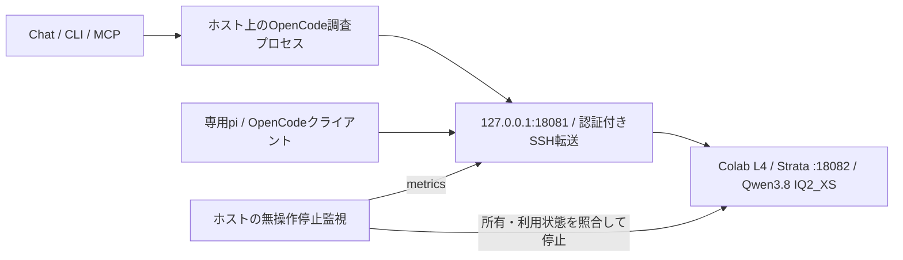

# Strata × Qwen3.8-Flash-NextをColabで起動する

参照セッションの「Colab L4、Qwen3.8 IQ2_XS、64K、SSH転送、無操作30分停止」を、このリポジトリのCLIへ組み込んだ手順です。Googleへのログイン、APIキー、SSH鍵、モデル本体、推論ログはGitへ入れません。

通常の`run --agent opencode`は接続済みのモデルを利用し、GPUを割り当てません。**`strata up`だけが明示的にColabを起動**します。Colabの計算ユニットを消費し、モデルの初回取得・準備には時間と大きな空き容量が必要です。GPUや供給状況によるfallbackは行いません。

## 構成



OpenShell MicroVMとは別の推論先です。OpenCodeの調査プロセスとWeb取得はホスト側で動き、推論がColabへ送られます。Colabを使ったから調査プロセスまでMicroVM隔離された、という構成ではありません。

## 1. CLI・認証を準備

ホストはmacOSまたはLinux、Node.js 22以降、Python 3.12以降、OpenSSHが必要です。

```sh
npm ci
npm run build
# 専用venvへgoogle-colab-cli 0.7.5を導入
npm start -- strata install
# 本人がターミナルの案内に従いGoogleへログイン
npm start -- strata login
```

既に導入・認証済みのCLIを使うなら、`.env`へ`COLAB_BIN=/absolute/path/to/colab`を設定し、installを省略できます。SSH転送の安全な接続先固定処理は0.7.5で検証するため、異なるバージョンは自動更新せず停止します。`COLAB_PYTHON`を指定する場合は、そのCLIのvenvのPythonです。認証コードやトークンをチャットへ貼り付けないでください。

## 2. 計画を確認して起動

```sh
# 設定を見るだけ。Google認証・GPU割当・モデル取得・推論なし
npm start -- strata plan

# L4を確保し、モデル準備・鍵回収・SSH転送・停止監視まで実施
npm start -- strata up
# テキスト専用なら明示的に画像エンコーダーを無効化できる
# npm start -- strata up --vision off

npm start -- strata status
```

固定するモデルと設定は[config/strata-colab.json](../config/strata-colab.json)です。

| 項目 | 設定 |
| --- | --- |
| Colab CLI | 0.7.5 |
| Strata導入元 | 公式v0.2.13のinstall.shをSHA-256固定。配布物の署名検証は公式installerが実施 |
| モデル | `qwen3.8-flash-next-iq2_xs` |
| コンテキスト・同時実行 | 65,536 tokens・1 |
| GPU | L4。別GPUへ自動切替しない |
| 画像エンコーダー | 既定はGPU、VRAM予約3,072MiB。`--vision off` / `cpu`を起動時に選択可能 |
| session | `web-harness-qwen`。参照環境の既存sessionとは別の名前 |
| API | Colab内127.0.0.1:18082のみ。ランダムAPIキーで保護 |
| ローカル転送 | 127.0.0.1:18081のみ。SSHは専用鍵と専用known-hostsを使用 |
| 無操作停止 | 既定30分。`strata up --idle-minutes 60`で変更 |

起動前にColabのsessionを照会し、不在を確認できた場合だけ新規割当します。存在する場合は、自分の管理記録と接続先が一致するsessionを再利用します。知らない既存sessionや、使用中のローカルポートを上書きしません。

新規カーネルの接続準備待ちは、副作用のないディレクトリ作成だけを限定回数再試行します。モデル起動や推論を無条件に再送しません。起動失敗時には、この操作で所有を確認したColabの解放を試み、解放を確認できなければ明示します。通信障害や強制終了後は`status`と`stop`でも確認してください。

SSHのproxyは、上流CLIの「sessionがなければ自動作成」という経路を禁止します。sessionが消失・置換されたら接続を止め、別VMを自動で作成しません。HostKeyCheckingを無効にはしません。

## 3. 認証・SSE・ツール呼び出しを検証

```sh
npm start -- strata probe
```

次の4段階を検証し、秘密値を含まない結果を返します。

1. APIキーなしのモデル一覧がHTTP 401で拒否される。
2. 認証付き一覧に指定Qwenと64Kがある。
3. ストリーミング応答に本文と`[DONE]`が届く。
4. `echo`の構造化tool call → tool result → 最終回答まで往復する。

`probe`は短い推論を3回使います。GPUの新規割当やモデル再起動はしません。HTTP接続だけの確認を、ツールを使うruntimeの成功とは扱いません。

## 4. research runtime・Chat・MCPで使う

起動成功後は`.runtime/strata-colab/connection.json`から接続先とキーファイルの場所を読み、既存のOpenCode adapterへ渡します。JSONへキーそのものは埋め込みません。`STRATA_BASE_URL`等を環境で指定した場合はそちらが優先されるため、管理接続を使う場合はそれらを未設定にしてください。

OpenCode 1.19.5を導入し、`OPENCODE_BIN`を設定してください。検証済みの版と異なる場合は、勝手に他のCLI・モデルへ切り替えず停止します。

```sh
RUNTIME_EXECUTOR=local npm start -- doctor --agent opencode
RUNTIME_EXECUTOR=local npm start -- run \
  'この本の書名・税込価格・ISBNを引用つきで教えて。購入操作はしません。' \
  --agent opencode --mode auto \
  --url https://books.rakuten.co.jp/rb/18577690/ --json

# 接続確認後、OpenCode / localを選んだChatを起動
npm start -- strata chat --port 4311
```

Chatでは「実調査」を選びます。既に同じポートでdaemonが動いている場合はそれを停止してから起動するか、別のポートを指定してください。MCPクライアントの設定は通常どおり`clients --url`で生成し、Chatと同じdaemonへ接続します。

研究用OpenCodeプロセスは、専用HOMEと調査ツールだけを公開するMCPを使い、元の会話にattachしません。64Kの実サイズを確認し、出力のための余白と自動圧縮を設定します。モデルの有限コンテキストや通信断による失敗がなくなる保証ではありません。

## 5. pi / OpenCodeの対話型クライアント

```sh
# インストール済みのpiを専用設定で起動
npm start -- strata client pi
# 特定のpiを使う場合はSTRATA_PI_BINを設定

# OpenCodeを専用Strata + harness MCP設定で起動
npm start -- strata client opencode
```

piには専用の`models.json`と圧縮設定、OpenCodeには専用providerと自動圧縮・MCP設定を作成します。APIキーは環境で渡し、設定JSONへ直書きしません。別モデルやproviderへ引数で上書きする経路は受け付けません。

これらはホスト上の対話型coding agentです。research runtimeの制限されたツール実行とは分けてください。piのモデル設定はテキスト入力として登録し、Colabの画像APIが有効でもpiの添付画像を検証済みとは扱いません。pi/OpenRouterの無料枠とは独立した推論先で、有料providerへのfallbackはしません。設定上のtoken単価0を、Colabや契約を含む実費0とは扱いません。

## 6. 既存endpointへ接続する

別のツールで起動したColabや、参照セッションの既存サービスを使う場合：

```sh
npm start -- strata connect \
  --url http://127.0.0.1:18081/v1 \
  --key-file /absolute/path/outside/git/strata-api-key
npm start -- strata probe
```

この操作はモデルと64Kを検証して接続を登録するだけで、Colabを作成・再起動・停止しません。既存サービスのGPUを停止する権限を自動取得しません。外部endpointの自動停止も有効にしません。所有中のColabから接続先を変更する場合は、先に`strata stop`で停止してください。

通常の`run`や`strata client`は接続先が落ちても新しいGPUを割り当てません。必要なときだけ`up`を明示してください。

## 7. 無操作時の停止と明示停止

```sh
npm start -- strata status
npm start -- strata stop
```

`up`で所有するColabについて、認証付き`/metrics`の処理中・待機中・要求数・エンジン起動区間を観測します。30分の無操作後に別サンプルを取り、所有sessionの接続先も照合してからColab全体の停止を要求し、不在を再確認します。モデルだけの停止ではありません。

- 通信断、未知のmetrics、Macのスリープや時計の飛びは、無操作の証拠にせずタイマーをリセットします。
- ホストが起動し、ネットワークとSSH転送が生きている必要があります。監視が観測できない場合は`blocked`とし、GPUが停止したとは報告しません。
- 別クライアントから同じAPIへ要求が来ても、サーバー側の要求数に基づいて利用を検出します。
- クライアントを閉じたりSSH転送を終了したりするだけではGPUの解放にはなりません。
- 監視は観測に基づく停止処理で、ホスト停止・通信障害・リクエスト到着との競合を完全に排除する仕組みではありません。利用終了時は`stop`と`status`で確認してください。

## 環境変数

| 変数 | 意味 |
| --- | --- |
| `COLAB_BIN` | 既存Colab CLIのパス。未指定は専用venv、なければPATHから検索 |
| `COLAB_PYTHON` | Colab CLIのvenv Pythonを明示する場合 |
| `STRATA_PYTHON` | `strata install`でvenvを作るPython。3.12以降が必要 |
| `STRATA_STATE_DIR` | 管理データの保存先。既定は`RUNTIME_DIR/strata-colab` |
| `STRATA_COLAB_SESSION` | session名。既定は`web-harness-qwen` |
| `STRATA_LOCAL_PORT` / `STRATA_REMOTE_PORT` | loopback転送のポート。既定18081 / 18082 |
| `STRATA_PI_BIN` | 対話型piの実行ファイル。未指定はこのリポジトリのpi |
| `STRATA_BASE_URL` / `STRATA_KEY_FILE` / `STRATA_API_KEY` | 既存接続の明示指定。管理接続より優先。`up`とは混在させない |
| `OPENCODE_BIN` / `OPENCODE_MODEL` | OpenCodeの実行ファイル・モデル。モデルは指定Qwenに一致が必要 |

## 保存と配布

`.runtime/strata-colab/`へ接続先、所有記録、APIキー、専用SSH鍵、known-hosts、監視・操作ログ、クライアント設定を保存します。すべてGit管理外です。GoogleログインはColab CLI自身の認証保存先に置き、runtimeやGitへコピーしません。モデル本体はColabの`/content/strata-models`にあり、VM解放後は再取得が必要になる場合があります。

配布するのは起動用のPythonスクリプト、CLIコード、秘密のない固定設定だけです。`npm run package:cli`と`release:check`で確認します。ログは秘密値を含み得るため、丸ごと共有せず、マスクした診断だけを共有してください。

参照：[Strata](https://github.com/Niko1221/Strata)、[Terminal起動手順](https://github.com/Niko1221/Strata/blob/main/docs/TERMINAL_LAUNCH.md)、[Google Colab CLI](https://github.com/googlecolab/google-colab-cli)。参照セッションの運用を元に、このリポジトリ用の独立session・接続先固定・失敗時解放・検証を追加しています。
