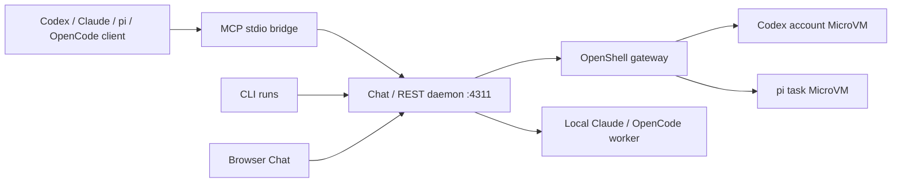

# CLI・MCP・Chat UI の使い方

同じ調査runtimeを、対話画面、CLI、coding agentのツールから使います。ローカルで完結する保存済み実測の再生と、外部サイト・モデルへ接続する実調査を明確に分けています。現在起動している画面は **http://127.0.0.1:4311/chat**。Recruitの青／楽天の赤を切り替えられる非公式のローカルUIです。画面のブランド切替は見た目を変え、調査先は入力URLで決まります。

## 1. まず画面で試す

この環境ではCodex用MicroVMの本人ログインが完了済みです。画面が既に起動中ならそのまま開きます。再起動する場合は、このリポジトリで次を実行します。

```sh
npm ci
npm run build
# 既存のOpenShell gatewayが起動していること
npm run sandbox:local -- run-codex chat --port 4311
```

左の「一日のお出かけ」「これからの暮らし」を選び、進め方と使うデータを選択します。

| 設定 | 体験 |
| --- | --- |
| 保存済み実測で体験 | 実際に取得した当時の回答・引用・計測値を再生。新しい推論なし。個人条件を変えた新しい回答ではない |
| 実調査 | 入力した質問・URLで新しく取得・推論。エンジンの利用枠を使う |
| Approval | 調査前に推奨案・別案・影響を表示。「この選択で進む」を押すまで調査しない。未確認が残れば受領／追加調査／同一候補URL追加を提示 |
| Auto | 推奨方針をruntimeが選択して履歴に記録。承認待ちを作らず、未確認事項を残した部分回答も返す |

右側に根拠・未確認事項・実行先・時間・トークン・費用の範囲を表示します。保存済み実測の費用は当時の値で、今回の再生の費用ではありません。途中停止、履歴復元、回答コピー、JSON表示に対応します。タブを閉じてもdaemonの調査は続きます。「調査を停止」またはCLI/MCPのcancelで中断します。daemonを再起動すると残ったrunning相談はinterruptedとなり、推論を自動再送しません。

実調査中は、準備・条件整理・ページ取得・根拠確認・回答のイベントが順次届きます。上部の「取得リンク」から調査中・回答後のカード一覧に移動できます。カードは実際に読み込んだURL、または取得に失敗した試行の記録です。「プレビューを開く」で保存された本文・引用、取得日時、方式、HTTPステータス（記録がある場合）を確認し、「元のページ」で掲載元を開けます。保存済み実測に引用しか残っていない場合は抜粋と明記します。プレビューを開いてもサイトを再取得しません。

連携先からは `GET /api/runs/RUN_ID/events` でServer-Sent Events（`run`イベント）を購読できます。各スナップショットの `artifacts` に取得リンクが入り、`GET /api/runs/RUN_ID/artifacts/ARTIFACT_ID` で本文または抜粋と引用を取得できます。再接続時は現在のスナップショットを受け取ります。

OpenShellを使わず、ホスト上のモデルプロセスで使う場合は以下です。これはMicroVM隔離ではありません。

```sh
RUNTIME_EXECUTOR=local RUNTIME_AGENT=codex npm run chat -- --port 4311
RUNTIME_EXECUTOR=local RUNTIME_AGENT=claude-code npm run chat -- --port 4311
RUNTIME_EXECUTOR=local RUNTIME_AGENT=opencode npm run chat -- --port 4311
```

同じ保存先に複数のdaemonを同時起動せず、1つのdaemonを全クライアントで共有してください。別環境はRUNTIME_DIRを分けます。APIはloopbackへbindし、Host/Origin/JSONを検査します。外部公開しません。

## 2. CLIを使う

### 単発で完了まで待つ

```sh
# CodexのChatGPTサブスクを、ログイン済みMicroVMで使う
npm run sandbox:local -- run-codex run-file examples/recruit-day-out.json \
  --mode auto --max-steps 105 --max-pages 16 --timeout 300 --json
npm run sandbox:local -- run-codex run-file examples/recruit-life-plan.json \
  --mode approval --max-steps 105 --max-pages 16 --timeout 300 --json

# 任意の質問と複数URL
npm run sandbox:local -- run-codex run \
  '箱根で温泉とアクセスを重視して宿を比較して。日付は未定' \
  --url https://www.jalan.net/yad330299/ https://www.jalan.net/yad371898/ \
  --mode auto --json

# 未達を同じ条件のまま追加調査する
npm run sandbox:local -- run-codex improve TASK_ID --mode auto --iterations 1 --timeout 180 --json
```

`run`のApprovalは調査後の不足を人に返します。Chatと同じ「調査前の方針選択」から操作する場合は次の`runs`を使います。

### Chat/MCPと同じ相談を操作する

daemonを先に起動します。CLIとMCPのstartはすぐ相談IDを返し、getで進捗・回答・gateを取得します。

```sh
npm start -- runs start 'この本の価格とサイン付きを確認して。不明なら不明のまま返して' \
  --url https://books.rakuten.co.jp/rb/18577690/ \
  --mode approval --agent codex --confirm-live --endpoint http://127.0.0.1:4311
npm start -- runs list --endpoint http://127.0.0.1:4311
npm start -- runs get RUN_ID --endpoint http://127.0.0.1:4311

# getで返ったgate.id / revision / choice.idをそのまま指定
npm start -- runs decide RUN_ID --gate GATE_ID --revision 1 --choice balance \
  --endpoint http://127.0.0.1:4311
# 調査後のgateにreturn_partialが提示された場合
npm start -- runs decide RUN_ID --gate RESULT_GATE_ID --revision 2 --choice return_partial \
  --endpoint http://127.0.0.1:4311
npm start -- runs cancel RUN_ID --endpoint http://127.0.0.1:4311
```

Autoなら`--mode auto`を指定し、decideは不要です。liveの利用枠使用は`--confirm-live`で明示します。保存済み再生には`--source replay --example day-out`を指定し、例の元条件の回答として扱います。`runs`で作成した相談はChat左側の履歴にも表示されます。従来の単発`run`のTaskは`show TASK_ID`およびWorkbenchのタスクAPIから参照します。

### バックエンドエンジンを変える

```sh
# 公式のサブスクログインを使用。モデル/認証の自動fallbackはしない
RUNTIME_EXECUTOR=local npm start -- run-file examples/recruit-day-out.json \
  --agent claude-code --model claude-haiku-5-5 --mode auto --json
RUNTIME_EXECUTOR=local npm start -- run-file examples/recruit-day-out.json \
  --agent claude-code --model claude-sonnet-5-5 --mode approval --json

# OpenRouterは現在ゼロ価格のツール対応モデルだけ。無料枠切れなら停止
npm run sandbox:local -- run run-file examples/recruit-day-out.json --mode auto --json

# 既存Strata endpointを利用。GPUを新規割当・起動しない
RUNTIME_EXECUTOR=local npm start -- run-file examples/recruit-day-out.json \
  --agent opencode --model strata-colab/qwen3.8-flash-next-iq2_xs --mode auto --json
```

`.env.example`に設定名を記載しています。CodexはVM内ChatGPTログイン、Claudeはclaude.ai、piはOpenRouter無料枠、OpenCodeは既存Strataの認証です。モデルを切り替えると利用枠も変わります。

## 3. MCPとしてcoding agentへ提供する

MCPは**stdio**（2025-11-25と以前の互換プロトコル）です。公開HTTP MCPではなく、永続daemonへのローカルbridgeです。MCPクライアントを閉じても、開始した調査はdaemonに残ります。stdoutにはJSON-RPCだけを出すため、クライアント設定では`npm start`ではなくNodeの絶対パスを使用します。

```sh
npm start -- clients --url http://127.0.0.1:4311
# .runtime/clients に5ファイル生成。ユーザー設定や既存セッションは変更しない
# codex.toml / claude.mcp.json / pi.mcp.json / opencode.json / opencode-strata.json
```

### Codex

生成された`codex.toml`の`[mcp_servers.harness]`を、使用したいCodexプロジェクトの設定へ追加できます。登録コマンドを使う場合は以下です（実行するとCodex側に登録されます）。

```sh
codex mcp add harness -- node /ABSOLUTE/PATH/web-harness-runtime/dist/cli.js mcp --url http://127.0.0.1:4311
codex mcp list
```

既存設定を変更したくない場合は、`clients`の出力にある`codexOverrides`をCodex CLIの引数に渡せます。今回の接続検証はこの一時設定で実施しました。

### Claude Code

```sh
claude --strict-mcp-config --mcp-config .runtime/clients/claude.mcp.json
```

`harness`のツールを発見し、次の依頼を渡します。Claude Code自身の利用枠と、調査バックエンドのCodex等の利用枠は別です。

### pi

Pi 1.5.0はネイティブMCPに対応しています。生成ファイルを、信頼したプロジェクトの`.pi/mcp.json`へ配置する方法、または登録コマンドを使えます。

```sh
mkdir -p .pi
cp .runtime/clients/pi.mcp.json .pi/mcp.json
./node_modules/.bin/pi mcp list
./node_modules/.bin/pi
```

Pi自身のproject trustと認証を使用します。OpenRouterモデルを選ぶ場合は無料モデルと無料枠を確認します。今回のPi接続試験は同梱MCPクライアントによる実呼び出しで、モデル推論を使用していません。

### OpenCode / 既存Strata

```sh
npm run opencode:client -- mcp list
npm run opencode:client
```

既存のOpenCode 1.19.5とStrata用profileを使用し、鍵はファイルから子プロセスの環境だけへ渡します。既存の会話へattachせず、GPUを新規割当・再起動しません。モデル推論を始める前に既存endpointの完全一致モデルを確認し、未接続なら停止します。汎用のOpenCode設定へMCPだけ追加する場合は`opencode.json`を利用します。

### agentへ渡す具体的な依頼

> harness_capabilitiesで実行先を確認してください。harness_startで「上野で家族3人が一日遊ぶ案」をmode=approval、agent=codex、指定URLで開始し、harness_getで取得してください。needs_inputになったら、推奨案・別案・追加時間と利用枠を私に見せてください。私が選ぶまでharness_decideは実行しないでください。回答には引用、未確認事項、VM実行情報、時間と費用の計測範囲を含めてください。

| MCP tool | 操作 |
| --- | --- |
| harness_capabilities | executor・対応エンジン・モード |
| harness_start | query / urls / mode / agent / source / confirmLive。即時にrun IDを返す |
| harness_get | idでpoll。回答・gate・revision・metricsを取得 |
| harness_list | 保存した相談の一覧 |
| harness_decide | id / gateId / revision / choiceId / confirmedByUser=true。古い選択や内容を変えた再送を拒否 |
| harness_cancel | idの調査を中断 |

Autoを依頼する場合はmode=autoとし、推奨選択はruntimeの判断として記録します。ApprovalのconfirmedByUserは利用者に選択を提示した後にだけ指定します。stdioのJSON-RPC IDの同一再送を重複排除します。これに加え、HTTP側でもgate IDとrevisionで承認の二重実行を防ぎます。

## 4. VMで立ち上げる

現在の実測構成は、Mac上のChat/API/daemonとOpenShell gateway、調査プロセスを実行するMicroVMです。Chat/APIまでMicroVM内で動いたという主張ではありません。



| 役割 | Codex | Claude Code | pi | OpenCode |
| --- | --- | --- | --- | --- |
| MCPクライアントとして使う | 実モデル呼び出し確認 | Haiku実モデル呼び出し確認 | 同梱MCPクライアントで確認 | 既存1.19.5の接続確認 |
| local調査バックエンド | 対応 | 対応 | 対応 | 既存Strata対応 |
| OpenShell調査バックエンド | 専用認証VMを再利用 | 未対応 | タスクごと発行 | 未対応 |

Claude/OpenCodeをクライアントにし、調査はCodex MicroVMに委譲できます。この場合、Claude/OpenCode自身がMicroVM内で動くことにはなりません。

### 現在のApple Silicon Macで初回構築する場合

```sh
npm run build
docker build --provenance=false -f infra/openshell/Dockerfile -t web-harness-runtime:local .
docker build --provenance=false -f infra/openshell/Dockerfile.codex -t web-harness-codex:local .
npm run sandbox:local -- setup
npm run sandbox:local -- start
# 別ターミナル
npm run sandbox:local -- register
npm run sandbox:local -- codex-setup
npm run sandbox:local -- codex-login  # 初回だけ公式画面で本人がログイン
npm run sandbox:local -- run-codex chat --port 4311
```

既存環境の認証ディスクを削除・再作成しません。詳細は[OpenShell手順](runtime-modes.md)と[Codex worker手順](codex-strata.md)。piには専用providerの`init-provider`が別途必要です。ホスト資格情報のVMコピーや、OpenAI有料APIへの自動切替は行いません。

### 自分のLinux VMにChat/API/CLIを置く場合

Linux VMへのSSHとNode 22以上を前提に、VM内でリポジトリを展開してdaemonを実行できます。以下は提供手順で、今回remote VMへの配置は実行していません。

```sh
# VM内。リポジトリをcloneしてそのディレクトリへ移動後
npm ci
npm run build
# まず保存済み実測の再生を利用。実調査は別途エンジン認証が必要
RUNTIME_EXECUTOR=local RUNTIME_AGENT=codex npm start -- chat --port 4311

# 手元のPC。自分のVM名に置き換えてトンネルを保持
ssh -N -L 4311:127.0.0.1:4311 USER@YOUR_VM
# ブラウザで http://127.0.0.1:4311/chat
# MCP bridgeもHARNESS_URL=http://127.0.0.1:4311を使用
```

VM内でCodexをlocalエンジンとして利用するなら、そのVMへ公式Codex CLIをインストールし本人がdevice loginします。`local`はそのVM内のプロセスという意味で、OpenShellのsandbox IDは付きません。別のOpenShell gatewayへ割り当てる場合は、VM内で動作確認済みのgatewayを登録してRUNTIME_EXECUTOR=openshell / OPENSHELL_GATEWAY / OPENSHELL_BINを設定し、専用Codex workerをsetup/loginしてください。`sandbox:local setup`はDarwin arm64用で、Linux用のgateway installerではありません。

Linuxのホストネットワークを使用できるVMでは、同梱のCodexイメージからChat daemonを起動することもできます。loopback bindingを保つため、ブラウザアクセスは上のSSH tunnelを使用します。保存済み再生は認証なし、実調査はその実行環境で公式ログインが必要です。

```sh
docker run --rm --network host --user node --workdir /workspace \
  web-harness-codex:local node /opt/web-harness/dist/cli.js chat --port 4311
```

公開インターネットへのHTTP/MCP公開、共有アカウント、多ユーザー認可、常駐サービス管理、VMディスクの累積上限は今回の提供範囲外です。外部公開が必要なら、認証・利用者ごとの保存先・利用枠を追加する設計が必要です。

## 5. 実際に確認した結果

[回答全文と費用・レイテンシー](delivery-results.md)、[機械可読の記録](evidence/delivery-results.json)。

- MCP公式SDK 1.32.2でinitialize / 6ツール発見 / 2テーマの実調査開始を確認。stdioクライアント終了後もdaemonが完走。
- Codex / Claude Haiku 5.5がharness_capabilitiesを実際に呼び出してexecutor=openshellを回答。
- Pi同梱MCPクライアントで6ツール取得・呼び出し。OpenCodeはharness connectedを確認。Pi/OpenCodeのモデル推論まで実施したという結果ではない。
- ChatのApprovalをサンプルの実調査で検証。方針待ち→MicroVM調査→サインunknownによる結果待ち→受領。選択は自動QAによるテスト操作。
- Hot Pepperの土日ランチ、カーセンサーの現行車両2件、Recruit Agentの個別求人をMicroVMの公開HTMLで取得。Indeedは403を保持し、別ソースによる補完と区別。
- MicroVMのChromium DOM取得は未解消。成功した取得はpublic-html経路であり、DOM必須サイト全般の成功とは主張しない。

## 6. CLIをローカル配布する

```sh
npm run package:cli
# .runtime/releases/web-harness-runtime-0.3.0.tgz と manifest.json を生成
# 別のPC/VMへファイルを渡してインストールする場合
npm install --global ./web-harness-runtime-0.3.0.tgz
web-harness --version
web-harness chat --port 4311
web-harness clients --url http://127.0.0.1:4311
```

npm registryへの公開は行っていません。package.jsonのfiles allowlistでJS・Web assets・公開設定・例・実測データだけを含め、.env・auth・セッション・node_modulesが入っていないことをpack後に検査します。SDKバージョンを固定し、tarballにもruntime-dependencies.jsonを入れて、OpenShellへ転送するコードとイメージの依存情報を照合できます。OpenShellそのもの・ブラウザの実行ファイル・モデル認証は別途必要です。ローカルVMのbootstrapはリポジトリ内のsandbox:localを使います。

既存の検証済みCodexイメージがある環境では、registryへ接続しない更新も用意しています。

```sh
npm ci
npm run build
docker build --network=none --provenance=false \
  -f infra/openshell/Dockerfile.release -t web-harness-codex:delivery .
# Linux VM上のloopback公開＋SSH tunnelの例
# docker run --rm --network host web-harness-codex:delivery
```

これは既存ベースイメージを更新する方法で、空の環境からの完全オフライン導入ではありません。保存済み実測の再生は、モデルや対象サイトに接続せず利用できます。
